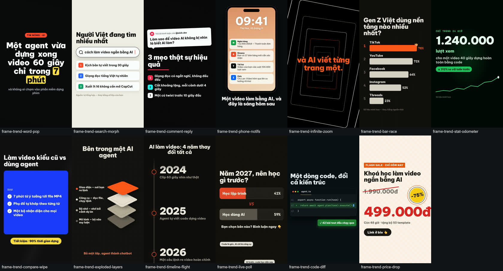
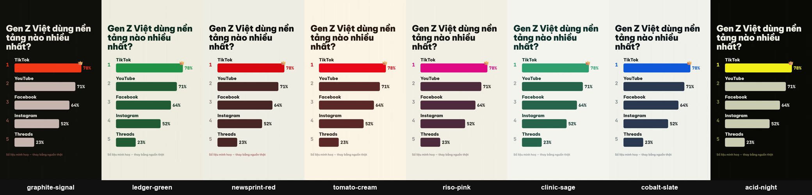
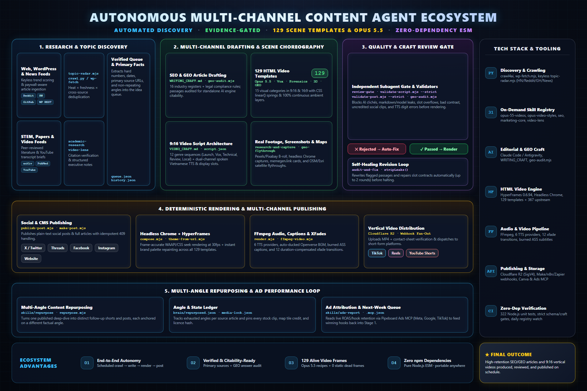

<div align="center">

# content-agent-kit

**A content toolkit tuned for Vietnamese creators: find what is hot, analyse competitors, write SEO/GEO-ready posts, gate them with an independent review, and render on-trend 9:16 video — one command each.**

[](https://github.com/XuHo-IT/Content-Agent-Kit/actions/workflows/ci.yml)
[](LICENSE)
[](#requirements)
[](#requirements)
[](https://github.com/XuHo-IT/Content-Agent-Kit/discussions)
[](CONTRIBUTING.md)

[🇻🇳 Tiếng Việt](README.md) · **English**

</div>

---

A scaffolding kit that lets agentic IDEs (**Claude Code**, **Antigravity / Gemini**) build and
run a complete content agent: topic research, competitor analysis, writing, quality gating,
social publishing, and **vertical 9:16 video** from 130 single-file HTML templates with
natural Vietnamese TTS, active-word captions, stock B-roll and live web captures.
No `npm install`; most features need no API key. The primary README is Vietnamese — this is
its English twin.

## ✨ What's new — November 2026

| | |
|---|---|
| 🧭 **Install as a plugin; every skill walks you through it** | `/plugin marketplace add XuHo-IT/Content-Agent-Kit`, or `install-skills.mjs --kit [--global]` to copy all 30 skills. Each skill now opens with a step table the agent narrates ("Bước 2/5 — …") → [`docs/29`](docs/29-bat-dau-nhanh.md) |
| 📖 **15 storytelling templates + 4 story genres** | Frames that do a job in a narrative — a page that turns on 8 fps stop-motion, one pen line that draws the whole arc, a halftone case file with a slamming stamp, a telestrator freeze-and-ring, a pencil-drawn chart, a letter that writes itself, sand animation, a story painted round a turning vase. Built by `build-story-templates.mjs` from the recipes of [ghost-editor](https://github.com/kurbaitaev/ghost-editor) and the storytelling prompts of awesome-opus5-5-videos; genres `brand-story`, `customer-story`, `legend`, `case-breakdown`; skill `story-video` → [`docs/27`](docs/27-storytelling.md) |
| 🔊 **CC0 sound pack + 2 edit styles** | `sfx-cc0.mjs` fetches 27 CC0 sounds (page turns, stings, risers, booms; reaction sounds kept out of auto-pick). `talking-head.mjs` gains `--style launch` and `--style meme` |
| 📣 **Facebook ads toolkit (8 skills)** | Creative test matrix and naming, fatigue detection, comment triage with Vietnamese teencode, pre-flight policy lint, catalog feed audit, RFM segments with hashed custom-audience files, KOC/UGC briefs, Vietnamese sale calendar — all offline on Ads Manager exports: `creative-matrix.mjs`, `fatigue-check.mjs`, `comment-triage.mjs`, `policy-lint.mjs`, `feed-audit.mjs`, `rfm-segments.mjs`, `promo-plan.mjs`, `VN_RETAIL_CALENDAR.template.json` → [`docs/28`](docs/28-facebook-ads.md) |
| 🎬 **13 new "trend" templates** | 2026 code-video grammar: active-word kinetic captions, search-bar morph, bar-race leaderboard, odometer stat, before/after wipe, exploded 3D cutaway, infinite zoom, phone notification storm, reply-to-comment, price slam. **They replace 27 older templates** that rendered as small cards in an empty frame with outdated copy |
| 🎨 **16 industry palettes** | One preset per vertical, on-trend and **free of AI-slop tells** (no violet→cyan gradients, no neon glow, no gradient-filled type) → [`docs/25`](docs/25-palettes.md) |
| 🧭 **Start here, and the kit keeps itself current** | `creator-start` asks a non-coder what they have (a phone take, a voice memo, a link, a topic) and routes them. `freshness-check` + `scripts/maintenance/freshness.mjs`: platform limits, Vietnamese ad and content law, AI-label rules and skill licences carry an expiry; when one has lapsed, the agent researches the official sources and updates the kit (`licence-watch.mjs` monthly in CI) |
| 📈 **Learns from what was posted** | `performance-review` + `scripts/analytics/perf.mjs`: import the CSV from TikTok Studio / Meta Business Suite / YouTube Studio (or public YouTube numbers), match each post to the video the kit made, and report which genre, length, hook shape and hour beat the channel's own median — only with ≥ 3 posts a side. `scripts/research/ai-mentions.mjs`: does an AI assistant name your brand? `transcript-diff.mjs`: score a speech model before switching |
| 🎬 **Editing techniques + upload check** | Cut on action, match cut, J/L-cuts, cutting to the beat (`beat-grid.mjs`, `talking-head --snap-beats`); `delivery-check.mjs` checks the real file against TikTok / Reels / Shorts / Shopee / Zalo limits (sourced, dated) and `--fix` re-encodes to fit; `compare.mjs` before/after; `--silence auto` → [`docs/31`](docs/31-ky-thuat-dung.md) |
| ✂️ **Silence auto-cut** | `autocut.mjs`: raw talking-head take in, jump-cut reel out — punch-ins, -16 LUFS, 9:16, ffmpeg only. Method from [ghost-editor](https://github.com/kurbaitaev/ghost-editor) → [`docs/26`](docs/26-auto-edit.md) |
| 💬 **Active-word captions** | 2–3 words per card, the spoken word lit in the theme accent — burned over footage and talking heads (`talking-head.mjs`, `--caption-style active`); template frames carry their own kinetic text |
| 🔍 **Competitor analysis** | `competitor-scan.mjs`: YouTube channels + any RSS site (Vietnamese news sections included) → breakouts, title devices, posting slots, and **topic gaps** against your own history → [`docs/24`](docs/24-competitor-analysis.md) |
| 📈 **Multi-platform trends** | New keyless **Google Trends (Vietnam)** source. With `APIFY_TOKEN`, the radar and competitor scan add **TikTok, Instagram, YouTube, Facebook** via Apify (optional, paid, with a cost knob) |
| 🧹 **Outdated parts fixed** | hyperframes 0.6 → 0.9.28 (render-verified); four registry skills that no longer installed repaired; ElevenLabs default switched to a model that **speaks Vietnamese**; the Veo backend lists the models a key can call before billing (the preview ids were retired) |
| 🔤 **Vietnamese-safe fonts** | Four families without Vietnamese glyphs were replaced across 12 templates; `font-check.mjs` + a test keep it that way |
| 🐛 **Opus 5.5 templates fixed** | The six `frame-opus-*` templates always rendered their demo copy — they read a global hyperframes never defines. Fixed, with a regression test |
| 🎞️ **3 new genres** | `comment-reply`, `flash-deal`, `data-story` — fifteen in total |

## Sample Outputs

| Format | Description & Links |
|---|---|
| 📄 **Article** | [Sample Post](examples/ai-news-social/sample-output/) — SEO/GEO-compliant article with engagement prompts and a 10-point quality audit |
| 🖼️ **Cover Image** | [Cover Image](examples/ai-news-social/sample-output/cover.jpg) — 1024×1024 visual matching the article |
| 🎬 **9:16 Video** | [Sample Video](examples/ai-video-social/sample-output/) — 2m 12s, natural TTS narration, Pexels footage, live website capture |
| 🎨 **Theme Repainting** | [Paper-Blue Sample](examples/ai-video-social/sample-output-paper-blue/) — 16 scenes across 14 of the 130 templates, repainted via `"theme": "paper-blue"` |

> **Download Sample MP4:** [Releases v0.1.0](https://github.com/XuHo-IT/Content-Agent-Kit/releases/tag/v0.1.0) or render locally:
> `node scripts/video/render.mjs examples/ai-video-social/sample-output/script.json`

---

## Quickstart in 3 Steps

### 1. Scaffold an agent for your vertical
- **Claude Code:** run `/bootstrap-content-agent` — it interviews you and scaffolds the agent, including the vertical's palette and video frames.
- **Antigravity / Gemini:** *"Read `AGENTS.md` and `docs/`, then build a content agent for [topic]."*

### 2. Every morning
```text
"what's hot in AI coding?"          → topic-radar: five keyless sources (+ TikTok/YouTube via Apify)
"analyse competitors @a @b"         → competitor-analysis: breakouts, titles, gaps
"run today"                         → daily-run: write → review gate → schedule
```

### 3. Make the video
```bash
node scripts/video/validate-script.mjs brain/<slug>/script.json --strict
node scripts/video/render.mjs brain/<slug>/script.json
node scripts/video/contact-sheet.mjs brain/<slug>/video.mp4
# someone speaking on camera? cut, reframe 9:16, active-word captions
node scripts/video/transcribe.mjs take.mp4          # word timings (any OpenAI-compatible server, or faster-whisper)
node scripts/video/talking-head.mjs take.mp4 --transcript take.transcript.json --theme <preset>
```

---

## 🎬 13 Trend Templates (new)

[](video-templates/CATALOG.md)

Drawn from a survey of the 703 prompts in [awesome-opus5-5-videos](https://github.com/yihui-dev/awesome-opus5-5-videos)
and ghost-editor's talking-head grammar. Enforced by tests: headline type ≥ 88px in 9:16, an
entrance + a mid-scene beat + an ambient loop, no AI-slop palette tells, and demo numbers
labelled as illustrative.

| template | for |
|---|---|
| `frame-trend-word-pop` | 2-second hook: a sentence lands word by word, the payoff lit |
| `frame-trend-search-morph` | "people are searching for…": dot → search bar → typed query → answers |
| `frame-trend-comment-reply` | "Replying to @…" — the most common Vietnamese TikTok opener |
| `frame-trend-phone-notifs` | a phone buzzing with orders, messages, views |
| `frame-trend-infinite-zoom` | endless zoom for a "go deeper" reveal |
| `frame-trend-bar-race` | rankings drawn from the numbers, leader crowned |
| `frame-trend-stat-odometer` | one big number, every digit rolling, sparkline drawn |
| `frame-trend-compare-wipe` | before/after — a glowing divider wipes the "after" in |
| `frame-trend-exploded-layers` | "what's inside X" — a 3D stack pulls apart, each layer labelled |
| `frame-trend-timeline-flight` | a camera flight along a timeline, stopping at each milestone |
| `frame-trend-live-poll` | A/B poll battle with floating comments and a comment prompt |
| `frame-trend-code-diff` | one line changed everything — strike red, type green, tests pass |
| `frame-trend-price-drop` | flash sale — old price slashed, new price slammed, stamp |

---

## 🎨 Industry palettes, no AI slop

[](docs/25-palettes.md)

One `"theme": "<preset>"` line recolours every scene. Each vertical in
`templates/INDUSTRIES.template.json` has its own: `graphite-signal` (AI/tech),
`terminal-moss` (programming), `tomato-cream` (e-commerce/food), `riso-pink` (marketing/beauty),
`terracotta-sand` (travel), `acid-night` (gaming), `newsprint-red` (news), `ledger-green`
(finance), `limestone-clay` (real estate), `clinic-sage` (health), `oxblood-paper` (law),
`chalk-marigold` (education), `cobalt-slate` (B2B/SaaS), `archive-sepia` (history),
`safety-orange` (logistics), `moss-paper` (environment). A brand of your own:
`node scripts/video/theme-from-url.mjs --url https://your-site`. Why these read as chosen
rather than generated: [`docs/25-palettes.md`](docs/25-palettes.md).

---

## 🚀 End-to-End Workflow

[](examples/gallery/workflow.png)

---

## The 130-template library

Every template ships 16:9 and 9:16, an ambient motion layer, and Vietnamese-capable fonts.
Galleries (Vietnamese labels) are in the [detailed guide](docs/00-huong-dan-chi-tiet.md#thư-viện-130-template-theo-nhóm) — the newest is the [storytelling set](examples/gallery/gallery-story.jpg);
the full slot contracts and character limits are in
**[`video-templates/CATALOG.md`](video-templates/CATALOG.md)**, and scene sequences for the 19
genres in **[`docs/21-video-genres.md`](docs/21-video-genres.md)** &
**[`templates/VIDEO_GENRES.template.json`](templates/VIDEO_GENRES.template.json)**.

---

## Key Capabilities

| Capability | Details |
|---|---|
| **6 voice providers** | OmniVoice (local, free), Vbee, Viettel AI, FPT AI, ElevenLabs, HTTP custom adapter |
| **130 templates, 20 genres** | Review, Tutorial, News, Listicle, Launch, Testimonial, Local, Vox Explainer, GEO Answer, Technical Deep-Dive, Growth Strategy, GEO Itinerary, **Comment Reply, Flash Deal, Data Story, Brand Story, Customer Story, Legend, Case Breakdown, Comment Story** |
| **Captions & transitions** | `--captions burn` + `--caption-style active`; 12 transitions (fade, swipe, slide, iris, pixelize, zoom, whip, radial, slice, squeeze, reveal, cover) |
| **Auto-edit your footage** | `autocut.mjs` — silence removal, punch-ins, -16 LUFS, 9:16, a reviewable cut list |
| **Topic & competitor research** | `topic-radar.mjs` (HN, GitHub, Google News, **Google Trends VN**, Reddit) and `competitor-scan.mjs` (YouTube + RSS), keyless. Add `APIFY_TOKEN` for **TikTok, Instagram, YouTube, Facebook** via Apify (optional, paid) |
| **Real footage & captures** | Pexels/Pixabay B-roll, headless-Chrome captures, memes, map fly-throughs |
| **Palettes** | 16 industry presets + `theme-from-url.mjs` for brand colours |
| **GEO / answer-engine audit** | `geo-audit.mjs` scores how quotable a draft is for SearchGPT, Perplexity, Google AI Overviews |
| **Vietnamese fonts** | `font-check.mjs` verifies every template font carries Vietnamese glyphs |

---

## Repository Structure

| Directory | Role |
|---|---|
| `docs/` | 26 methodology guides (bilingual VI + EN): writing, GEO, topic radar, competitor analysis, video pipeline, palettes, auto-edit, ad MCPs, Canva |
| `templates/` | Scaffolds: `PLAYBOOK`, `WRITING_CRAFT`, `VIDEO_CRAFT`, `KNOWLEDGE`, `VIDEO_SCRIPT.json`, `sources.yaml`, `INDUSTRIES.template.json` (16 industries, one palette each) |
| `scripts/` | Zero-dependency CLIs: crawl, social publish, quality audit, video render, autocut, competitor scan, stock B-roll, screenshots |
| `video-templates/` | 130 single-file HTML video templates plus **`CATALOG.md`** — self-contained CSS & animation, rendered offline. 456 more are one command away. |
| `skills/` | 30 runtime skills: `creator-start`, `bootstrap-content-agent`, `daily-run`, `review-gate`, `audit-and-fix`, `crawl-and-queue`, `topic-radar`, `competitor-analysis`, `daily-topic-video`, `create-video`, `video-and-post`, `research-and-capture`, `repurpose`, `ads-report`, `design-campaign`, `geo-optimize`, `motion-craft`, `new-template`, `story-video`, `talking-head-edit`, `ads-creative-lab`, `ads-fatigue-watch`, `ads-comment-triage`, `ads-policy-check`, `catalog-feed-audit`, `audience-plan`, `ugc-koc-brief`, `promo-calendar`, `freshness-check`, `performance-review` + `registry.json` (48 on-demand skills incl. `lemo-opuscar`, `agent-browser`, `web-video-presentation`, `watch-video`, `ghost-editor`, `opus-55-videos`, `xilo-opus-video`) |
| `examples/` | 2 end-to-end reference agents: AI news social and vertical video production |

## Requirements

- **Node.js ≥ 18** (required)
- **Chrome/Chromium + FFmpeg/ffprobe** (video rendering and `autocut.mjs`)
- **Python 3.12** (only for the optional `crawl4ai` pipeline)

> **Zero `npm install` / no `package.json`** — the kit is self-contained and portable.

## License & Attribution

- License: **MIT** (see [`LICENSE`](LICENSE)).
- Lineage & third-party attributions: **[`NOTICE.md`](NOTICE.md)**.
