<div align="center">

# content-agent-kit

**Bộ công cụ cho người làm nội dung Việt: tìm chủ đề hot, phân tích đối thủ, viết bài chuẩn SEO/GEO, duyệt tự động và dựng video 9:16 chuẩn xu hướng 2026, chỉ bằng một câu lệnh.**

[](https://github.com/XuHo-IT/Content-Agent-Kit/actions/workflows/ci.yml)
[](LICENSE)
[](#yêu-cầu)
[](#yêu-cầu)
[](https://github.com/XuHo-IT/Content-Agent-Kit/discussions)
[](CONTRIBUTING.md)

**🇻🇳 Tiếng Việt** · [English](README.en.md)

</div>

---

Bộ kit giúp các IDE agentic (**Claude Code**, **Antigravity / Gemini**) tự dựng và vận hành
một AI Content Agent hoàn chỉnh cho thị trường Việt. Agent làm trọn chuỗi: săn chủ đề, soi
đối thủ, viết bài, chấm chất lượng, đăng mạng xã hội, và **dựng video ngắn 9:16** với 115
template HTML động, giọng đọc tiếng Việt tự nhiên, phụ đề sáng từng từ, B-roll và ảnh chụp
web thật.

Không cần `npm install`. Hầu hết tính năng không cần API key.

## ✨ Có gì mới — tháng 11/2026

| | |
|---|---|
| 🎬 **13 template "trend" mới** | Bám theo xu hướng video viết bằng code 2026: caption sáng từng từ, thanh tìm kiếm biến hình, bảng xếp hạng chạy đua, số lăn kiểu đồng hồ, trước/sau quét ngang, mổ xẻ 3D, zoom vô tận, điện thoại nổ thông báo, "trả lời bình luận", giá sốc. **Thay thế 27 template cũ** vốn chữ tí hon, khung trống và nội dung lỗi thời |
| 🎨 **16 bảng màu theo ngành** | Mỗi ngành một bảng màu đúng xu hướng, **không "mùi AI"**: không gradient tím-xanh, không neon, không chữ tô gradient. Tài chính dùng xanh sổ cái, tin tức dùng đỏ nhà in, AI dùng than chì + cam tín hiệu → [`docs/25`](docs/25-palettes.md) |
| ✂️ **Tự cắt khoảng lặng** | `autocut.mjs`: đưa vào file quay thô, nhận lại bản jump-cut có punch-in, loudness -16 LUFS, crop 9:16. Chỉ cần ffmpeg. Phương pháp từ [ghost-editor](https://github.com/kurbaitaev/ghost-editor) → [`docs/26`](docs/26-auto-edit.md) |
| 💬 **Phụ đề sáng từng từ** | `--caption-style active`: mỗi lần 2–3 từ, từ đang đọc đổi màu theo theme. Đây là kiểu phụ đề người xem đọc ra là "có dựng", không phải auto-caption |
| 🔍 **Phân tích đối thủ** | `competitor-scan.mjs`: kênh YouTube + mọi trang có RSS (kể cả VnExpress, Tuổi Trẻ theo chuyên mục). Cho ra video bứt phá, công thức tiêu đề, giờ đăng và **khoảng trống chủ đề** bạn chưa làm → [`docs/24`](docs/24-competitor-analysis.md) |
| 📈 **Trend nhiều nền tảng** | Thêm nguồn **Google Trends VN** (keyless). Có `APIFY_TOKEN` thì radar và competitor-scan mở thêm **TikTok, Instagram, YouTube, Facebook** qua Apify (tuỳ chọn, trả phí, có núm chỉnh chi phí) |
| 🧹 **Dọn đồ lỗi thời** | Nâng hyperframes 0.6 → 0.9.28 (đã render thử). Sửa 4 skill ngoài không còn cài được. Đổi ElevenLabs mặc định sang model **có tiếng Việt**. Backend Veo hỏi API danh sách model trước khi tính tiền, vì bản preview đã bị Google tắt |
| 🔤 **Font chuẩn dấu tiếng Việt** | 4 font không có dấu tiếng Việt (Cinzel, Caveat, Fira Code, Cabinet Grotesk) đã được thay ở 12 template. Thêm `font-check.mjs` + test để lỗi này không quay lại |
| 🐛 **Sửa lỗi template Opus 5.5** | 6 template `frame-opus-*` trước đây **luôn hiện chữ mẫu** bất kể script truyền gì. Nguyên nhân: đọc một biến toàn cục không tồn tại. Đã sửa và có test chặn |
| 🎞️ **3 thể loại video mới** | `comment-reply` (trả lời bình luận), `flash-deal` (chốt đơn), `data-story` (câu chuyện số liệu). Nâng tổng số lên 15 |

## Xem nhanh kết quả mẫu

| Định dạng | Mô tả & Đường dẫn |
|---|---|
| 📄 **Bài viết** | [Bài viết mẫu](examples/ai-news-social/sample-output/): 951 từ chuẩn SEO/GEO, kèm comment tương tác và bảng kiểm định chất lượng |
| 🖼️ **Ảnh bìa** | [Ảnh cover](examples/ai-news-social/sample-output/cover.jpg): 1024×1024, đồng bộ phong cách bài viết |
| 🎬 **Video 9:16** | [Video mẫu](examples/ai-video-social/sample-output/): 2 phút 12 giây, giọng Vbee, footage Pexels, chụp web trực tiếp |
| 🎨 **Theme đổi màu** | [Bản paper-blue](examples/ai-video-social/sample-output-paper-blue/): 16 scene, dùng 14 trong số 115 template, đổi sang nền trắng chữ xanh biển qua `"theme": "paper-blue"` |

> **Tải video mẫu MP4:** [Releases v0.1.0](https://github.com/XuHo-IT/Content-Agent-Kit/releases/tag/v0.1.0) hoặc tự render:
> `node scripts/video/render.mjs examples/ai-video-social/sample-output/script.json`

---

## Bắt đầu trong 3 bước

### 1. Tạo agent cho ngành của bạn
- **Claude Code:** gõ `/bootstrap-content-agent`. AI sẽ hỏi bạn ngành nghề và mục tiêu, rồi dựng cả agent, gồm luôn bảng màu và bộ khung video hợp với ngành.
- **Antigravity / Gemini:** *"Đọc `AGENTS.md` và `docs/`, rồi tạo cho tôi một agent nội dung về [chủ đề]."*

### 2. Mỗi sáng
```text
"hôm nay có gì hot về AI coding?"        → topic-radar: 5 nguồn không cần key (+ TikTok/YouTube qua Apify)
"phân tích đối thủ @kenh-a @kenh-b"      → competitor-analysis: bứt phá, tiêu đề, khoảng trống
"tạo nội dung hôm nay"                   → daily-run: viết → duyệt → lên lịch đăng
```

### 3. Làm video
```bash
# Kiểm tra kịch bản (vài giây, đừng bỏ qua)
node scripts/video/validate-script.mjs brain/<slug>/script.json --strict

# Render: giọng đọc, footage, phụ đề sáng từng từ đốt thẳng vào video
node scripts/video/render.mjs brain/<slug>/script.json --captions burn --caption-style active

# Xem toàn bộ khung hình trong một ảnh
node scripts/video/contact-sheet.mjs brain/<slug>/video.mp4

# Có video tự quay? Cắt khoảng lặng + punch-in + 9:16 trước
node scripts/video/autocut.mjs quay-tho.mp4 --vertical --punch 0.12
```

---

## 🎬 13 Template Trend 2026 (mới)

[](video-templates/CATALOG.md)

Khảo sát 703 prompt trong [awesome-opus5-5-videos](https://github.com/yihui-dev/awesome-opus5-5-videos)
(motion 369 · 3D 117 · explainer 116), cộng với cách ghost-editor dựng video nói chuyện. Mỗi
template tuân theo các quy tắc sau, và các quy tắc này có test kiểm tra:
- **Đầy khung:** chữ tiêu đề ≥ 88px ở bản 9:16.
- **Ba lớp chuyển động:** vào cảnh, một nhịp giữa cảnh, và lớp nền chuyển động liên tục.
- **Không "mùi AI":** không gradient tím-xanh, không chữ tô gradient, không glow neon.
- **Số liệu mẫu gắn nhãn "minh hoạ":** template không bao giờ ship một con số trông như thật.

| template | dùng cho |
|---|---|
| `frame-trend-word-pop` | hook 2 giây đầu: câu nói hiện từng từ, từ khoá sáng lên |
| `frame-trend-search-morph` | "mọi người đang tìm…": chấm tròn rơi → thành thanh tìm kiếm → gõ → kết quả |
| `frame-trend-comment-reply` | "Trả lời bình luận của @…": kiểu mở đầu phổ biến nhất trên TikTok Việt |
| `frame-trend-phone-notifs` | điện thoại reo liên tục: đơn hàng, tin nhắn, lượt xem |
| `frame-trend-infinite-zoom` | zoom vô tận, cú twist "đi sâu hơn" |
| `frame-trend-bar-race` | bảng xếp hạng: độ dài thanh tính từ số liệu, người dẫn đầu đội vương miện |
| `frame-trend-stat-odometer` | một con số lớn, từng chữ số lăn như đồng hồ, kèm đường sparkline |
| `frame-trend-compare-wipe` | trước / sau, cũ / mới: vạch sáng quét qua để lộ bên "sau" |
| `frame-trend-exploded-layers` | "bên trong X có gì": khối 3D tách lớp, mỗi lớp một nhãn |
| `frame-trend-timeline-flight` | camera bay dọc dòng thời gian, dừng ở từng mốc |
| `frame-trend-live-poll` | bình chọn A/B: thanh giằng co, bình luận bay lên, kêu gọi comment |
| `frame-trend-code-diff` | một dòng code đổi cả kiến trúc: xoá đỏ, gõ xanh, test pass |
| `frame-trend-price-drop` | flash sale: giá cũ bị gạch, giá mới đập xuống, tem giảm giá |

---

## 🎨 Bảng màu theo ngành, không "mùi AI"

Một dòng `"theme": "<preset>"` trong `script.json` là đổi màu mọi scene. Mỗi ngành trong
`templates/INDUSTRIES.template.json` đã có sẵn preset riêng:

| ngành | preset | chất liệu & màu nhấn |
|---|---|---|
| AI, công nghệ | `graphite-signal` | than chì · chữ ngà · cam tín hiệu |
| Lập trình | `terminal-moss` | đen · chữ lân quang · xanh rêu-chanh |
| TMĐT, ẩm thực | `tomato-cream` | kem · nâu espresso · đỏ cà chua |
| Marketing, làm đẹp | `riso-pink` | giấy in riso · mực đen · hồng huỳnh quang |
| Du lịch | `terracotta-sand` | cát · nâu đất · đất nung |
| Game | `acid-night` | đen · trắng ngà · vàng chanh axit |
| Tin tức | `newsprint-red` | giấy báo · mực đen · đỏ nhà in |
| Tài chính | `ledger-green` | giấy sổ cái · xanh chai |
| Bất động sản | `limestone-clay` | đá vôi · than · đất sét nung |
| Y tế | `clinic-sage` | trắng ngà · teal sâu · xô thơm |
| Pháp lý | `oxblood-paper` | giấy bond · đỏ huyết dụ |
| Giáo dục | `chalk-marigold` | giấy phấn · navy · vàng cúc vạn thọ |
| Doanh nghiệp, SaaS | `cobalt-slate` | giấy lạnh · xám đá · xanh cobalt |
| Lịch sử, văn hoá | `archive-sepia` | giấy cũ · nâu đen |
| Logistics | `safety-orange` | xám bê tông · cam bảo hộ |
| Môi trường | `moss-paper` | giấy tái chế · xanh rêu |

[](docs/25-palettes.md)

Thương hiệu riêng? Đọc thẳng từ website: `node scripts/video/theme-from-url.mjs --url https://site-cua-ban`.
Vì sao các bảng màu này không bị "mùi AI": [`docs/25-palettes.md`](docs/25-palettes.md).

---

## 🚀 Sơ đồ vận hành

[](examples/gallery/workflow.png)

---

## Thư viện 115 template theo nhóm

Mỗi template có cả bản 16:9 và 9:16, lớp chuyển động nền liên tục, và font có đủ dấu tiếng Việt.

### 1. 🌟 Mở đầu & Hook (10)
[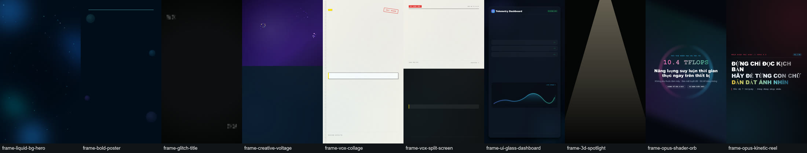](video-templates/CATALOG.md)
*`frame-liquid-bg-hero`, `frame-bold-poster`, `frame-glitch-title`, `frame-creative-voltage`, `frame-vox-collage`, `frame-vox-split-screen`, `frame-ui-glass-dashboard`, `frame-3d-spotlight`, `frame-opus-shader-orb`, `frame-opus-kinetic-reel`, cùng các hook trend ở trên.*

### 2. ✨ Công thức phong cách Opus 5.5 (6)
[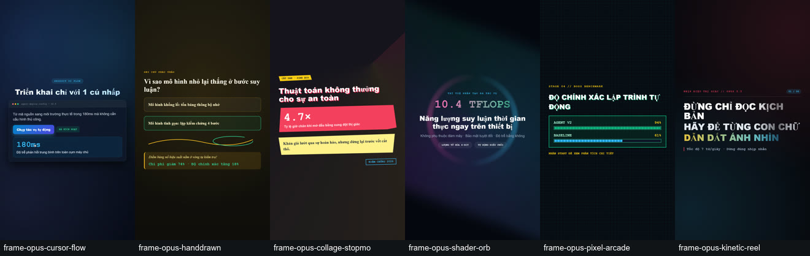](video-templates/CATALOG.md)
*`frame-opus-cursor-flow` (giao diện SaaS 3D + con trỏ nhấp), `frame-opus-handdrawn` (nét mực tự vẽ + line-boil 12fps), `frame-opus-collage-stopmo` (cắt dán giấy stop-motion), `frame-opus-shader-orb` (vòng plasma conic), `frame-opus-pixel-arcade` (HUD 8-bit), `frame-opus-kinetic-reel` (typography màn trập).*

### 3. 📰 Báo chí trực quan & Typography (12)
[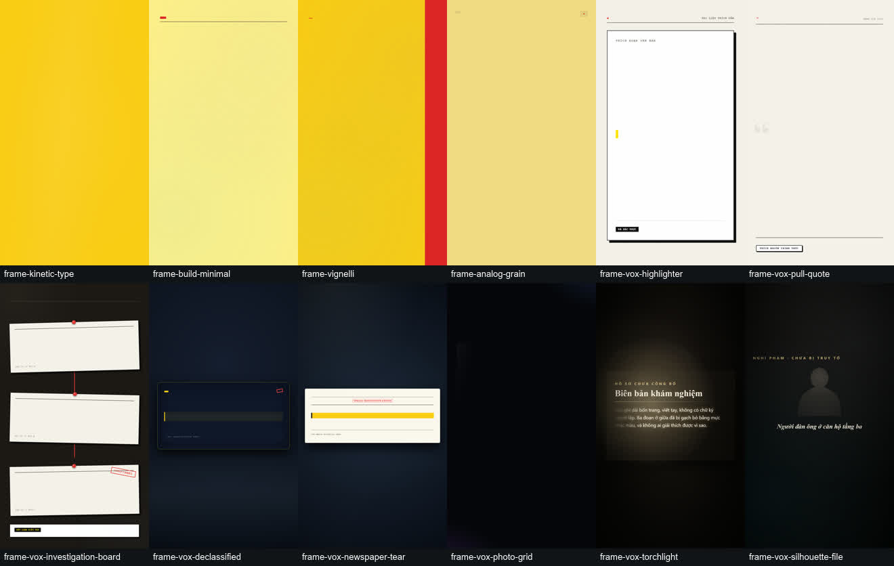](video-templates/CATALOG.md)
*`frame-kinetic-type`, `frame-build-minimal`, `frame-vignelli`, `frame-analog-grain`, `frame-vox-highlighter`, `frame-vox-pull-quote`, `frame-vox-investigation-board`, `frame-vox-declassified`, `frame-vox-newspaper-tear`, `frame-vox-photo-grid`, `frame-vox-torchlight`, `frame-vox-silhouette-file`.*

### 4. 📊 Số liệu & Biểu đồ (13)
[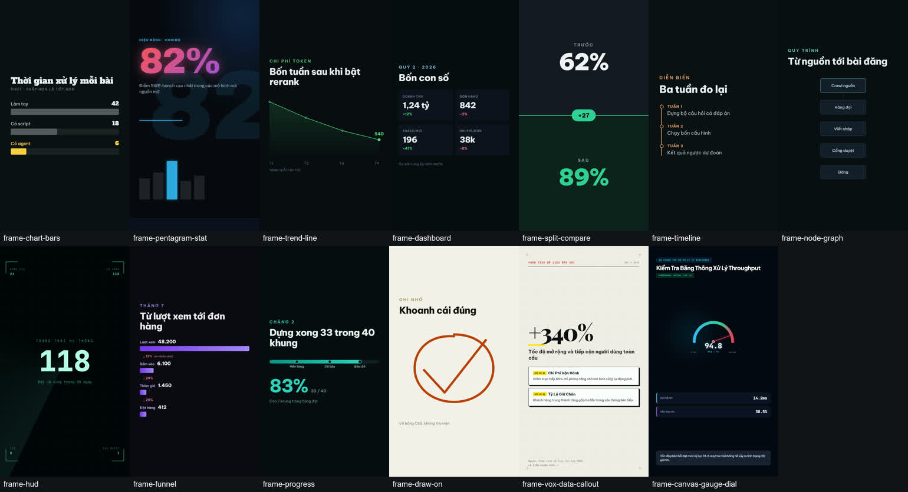](video-templates/CATALOG.md)
*`frame-chart-bars`, `frame-pentagram-stat`, `frame-trend-line`, `frame-dashboard`, `frame-split-compare`, `frame-timeline`, `frame-node-graph`, `frame-hud`, `frame-funnel`, `frame-progress`, `frame-draw-on`, `frame-vox-data-callout`, `frame-canvas-gauge-dial`.*

### 5. 🧠 Sơ đồ & Toán học (9)
[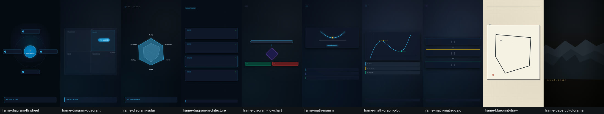](video-templates/CATALOG.md)
*`frame-diagram-flywheel`, `frame-diagram-quadrant`, `frame-diagram-radar`, `frame-diagram-architecture`, `frame-diagram-flowchart`, `frame-math-manim`, `frame-math-graph-plot`, `frame-blueprint-draw`, `frame-papercut-diorama`.*

### 6. 💻 Footage, IDE, Thiết bị & 3D (11)
[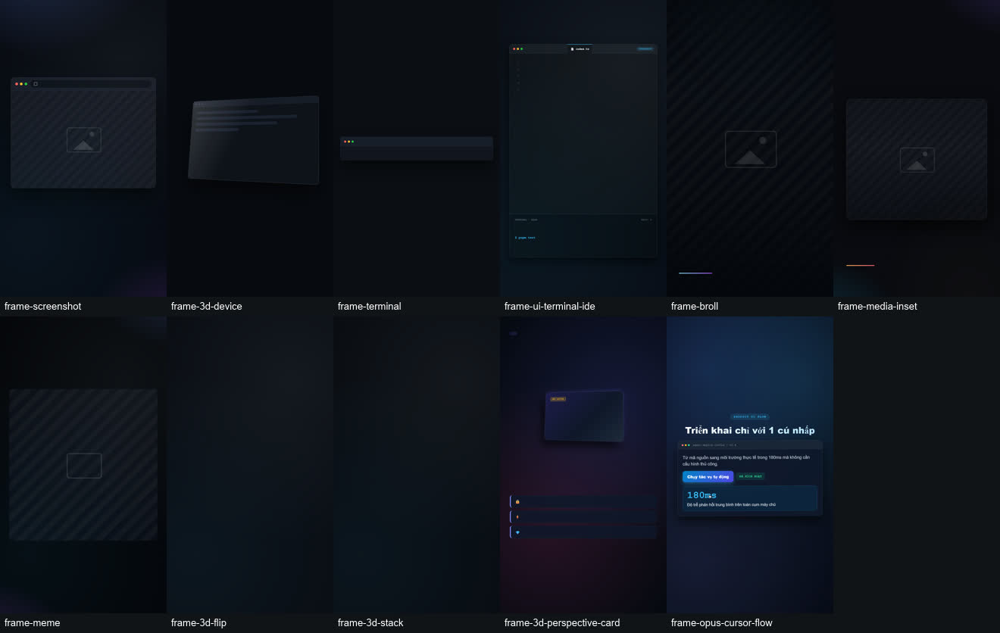](video-templates/CATALOG.md)
*`frame-screenshot`, `frame-3d-device`, `frame-terminal`, `frame-ui-terminal-ide`, `frame-broll`, `frame-media-inset`, `frame-meme`, `frame-3d-flip`, `frame-3d-stack`, `frame-3d-perspective-card`, `frame-opus-cursor-flow`.*

### 7. 🗺️ Bản đồ & Lịch trình (9)
[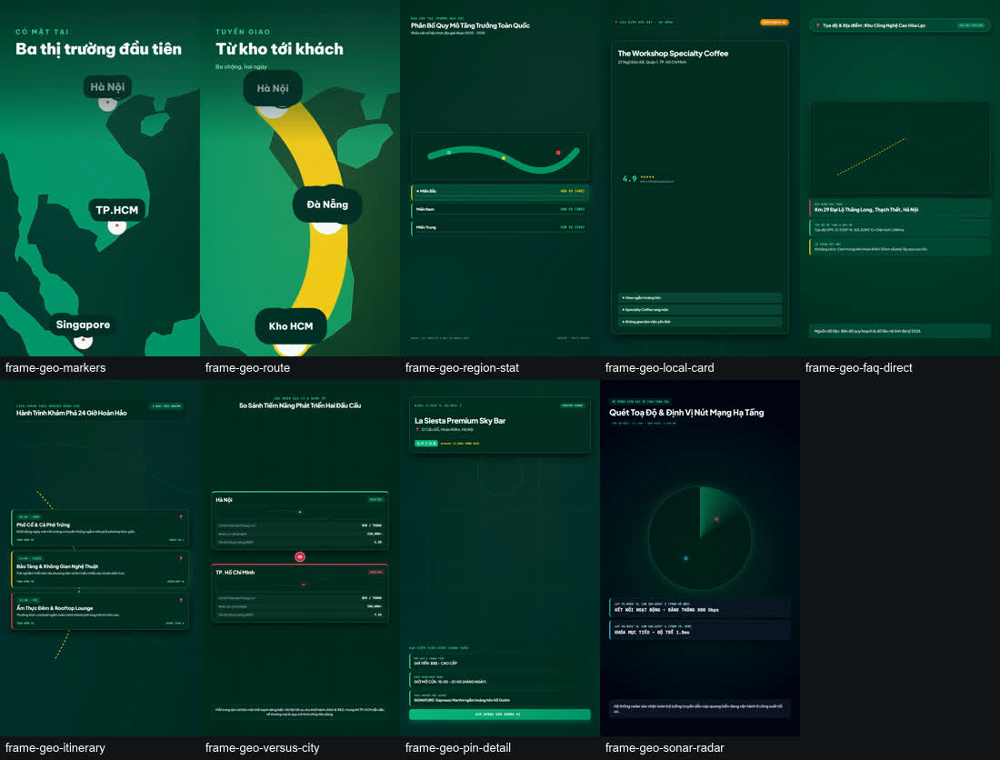](video-templates/CATALOG.md)
*`frame-geo-markers`, `frame-geo-route`, `frame-geo-region-stat`, `frame-geo-local-card`, `frame-geo-faq-direct`, `frame-geo-itinerary`, `frame-geo-versus-city`, `frame-geo-pin-detail`, `frame-geo-sonar-radar`.*

### 8. 🏆 Trình tự, Bằng chứng & Kết video (14)
[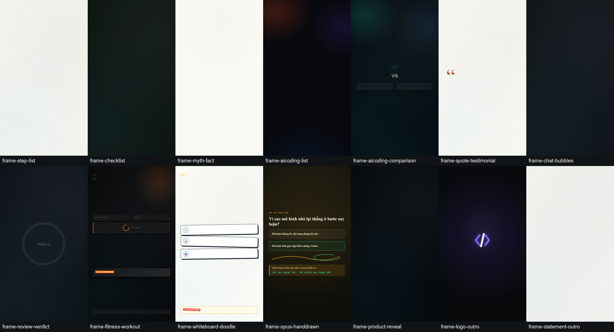](video-templates/CATALOG.md)
*`frame-step-list`, `frame-checklist`, `frame-myth-fact`, `frame-aicoding-list`, `frame-aicoding-comparison`, `frame-quote-testimonial`, `frame-chat-bubbles`, `frame-review-verdict`, `frame-fitness-workout`, `frame-whiteboard-doodle`, `frame-opus-handdrawn`, `frame-product-reveal`, `frame-logo-outro`, `frame-statement-outro`.*

### 9. ⚡ Hybrid đa kỹ năng (2)
[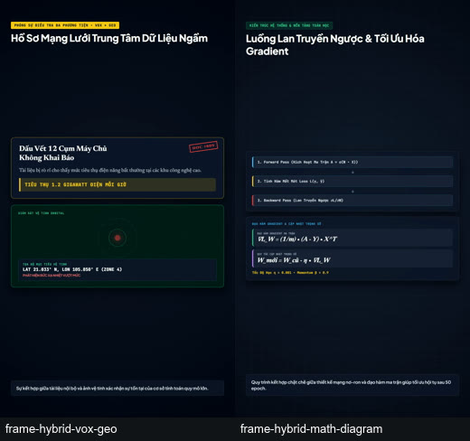](video-templates/CATALOG.md)
*`frame-hybrid-vox-geo`, `frame-hybrid-math-diagram`.*

### 10. 🕵️ Phim tài liệu & Điều tra (19)
[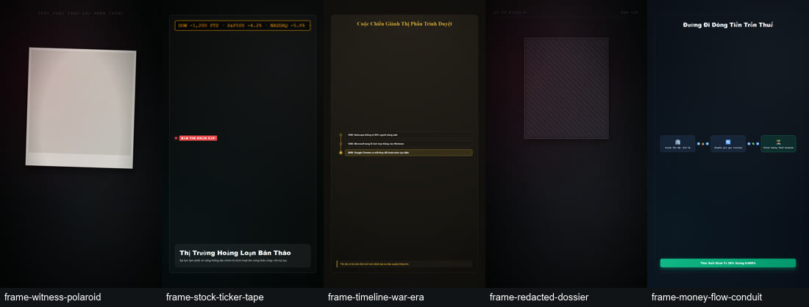](video-templates/CATALOG.md)
*`frame-redacted-dossier`, `frame-witness-polaroid`, `frame-archive-newspaper`, `frame-fingerprint-match`, `frame-crime-scene-map`, `frame-satellite-track`, `frame-corkboard-threads`, `frame-forensic-instrument`, `frame-case-dashboard`, `frame-interrogation-log`, `frame-morgue-tag`, `frame-cipher-decrypt`, `frame-vhs-nosignal`, `frame-suspect-lineup`, `frame-polygraph`, `frame-thermal-cam`, `frame-ballistics-path`, `frame-dispatch-waveform`, `frame-forensic-chat`.*

### 11. 📈 Tài chính & Xếp hạng
[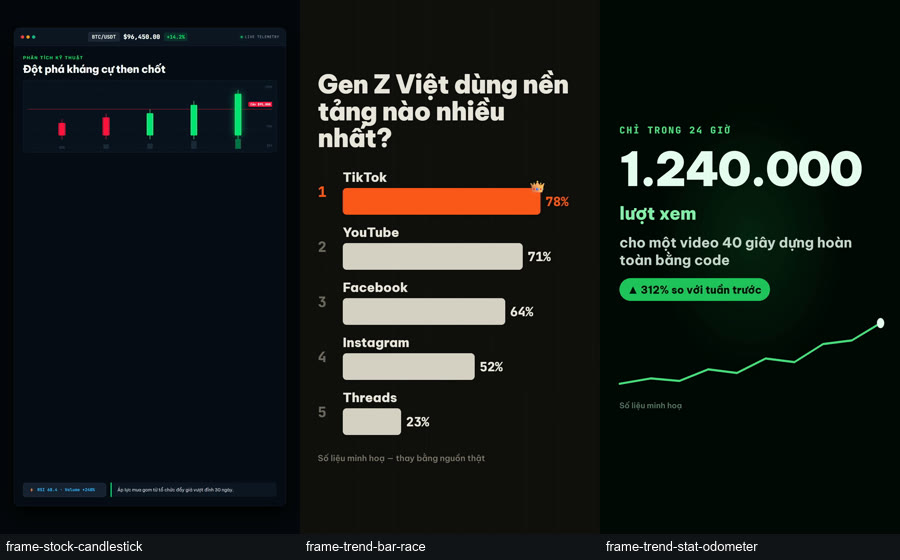](video-templates/CATALOG.md)
*`frame-stock-candlestick`, `frame-trend-bar-race`, `frame-trend-stat-odometer`.*

### 12. 🔬 Giải thích & Khoa học
[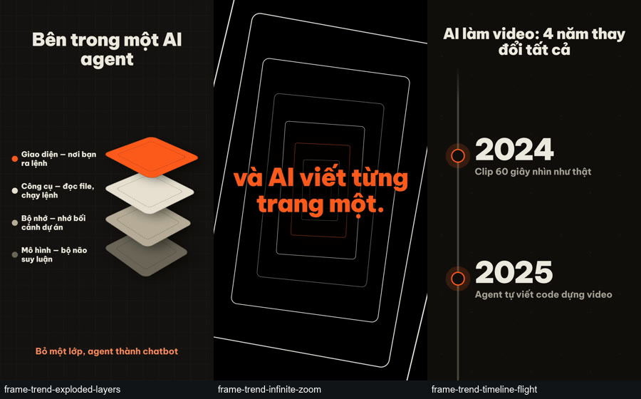](video-templates/CATALOG.md)
*`frame-trend-exploded-layers`, `frame-trend-infinite-zoom`, `frame-trend-timeline-flight`.*

### 13. 📱 Mạng xã hội & Tương tác
[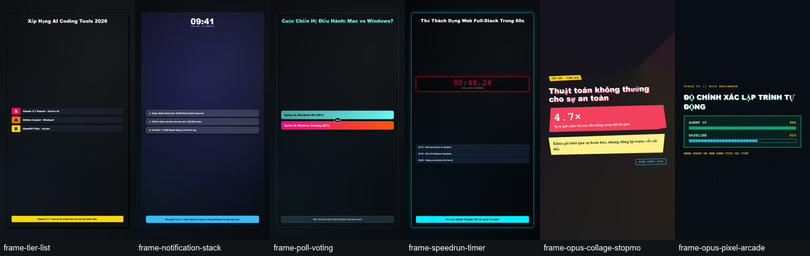](video-templates/CATALOG.md)
*`frame-trend-word-pop`, `frame-trend-comment-reply`, `frame-trend-live-poll`, `frame-trend-phone-notifs`, `frame-opus-collage-stopmo`, `frame-opus-pixel-arcade`.*

### 14. 💻 SaaS & Lập trình
[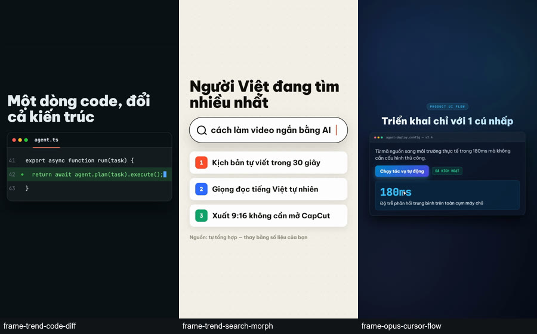](video-templates/CATALOG.md)
*`frame-trend-code-diff`, `frame-trend-search-morph`, `frame-opus-cursor-flow`.*

### 15. 🛒 Thương mại điện tử & Review
[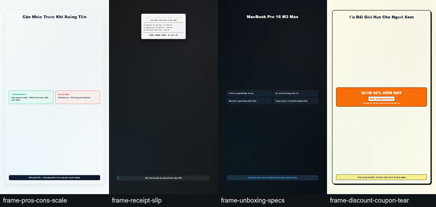](video-templates/CATALOG.md)
*`frame-trend-price-drop`, `frame-trend-compare-wipe`, `frame-review-verdict`.*

> Slot và giới hạn ký tự: **[`video-templates/CATALOG.md`](video-templates/CATALOG.md)**.
> Thứ tự scene cho 15 thể loại video: **[`docs/21-video-genres.md`](docs/21-video-genres.md)** & **[`templates/VIDEO_GENRES.template.json`](templates/VIDEO_GENRES.template.json)**.

---

## Tính năng chính

| Tính năng | Chi tiết |
|---|---|
| **6 bộ giọng đọc** | OmniVoice (local, miễn phí), Vbee, Viettel AI, FPT AI, ElevenLabs, adapter HTTP tuỳ chỉnh |
| **115 template, 15 thể loại** | Review, Hướng dẫn, Tin tức, Listicle, Ra mắt, Testimonial, Local, Vox Explainer, GEO Answer, Phân tích kỹ thuật, Tăng trưởng, Du lịch, **Trả lời bình luận, Flash sale, Câu chuyện số liệu** |
| **Phụ đề & chuyển cảnh** | `--captions burn` + `--caption-style active` (sáng từng từ). 12 kiểu chuyển cảnh: fade, swipe, slide, iris, pixelize, zoom, whip, radial, slice, squeeze, reveal, cover |
| **Tự dựng video quay** | `autocut.mjs`: cắt khoảng lặng, punch-in, -16 LUFS, 9:16, kèm danh sách cắt để duyệt |
| **Săn chủ đề & soi đối thủ** | `topic-radar.mjs` (HN, GitHub, Google News, **Google Trends VN**, Reddit) và `competitor-scan.mjs` (YouTube + RSS) — không cần key. Thêm `APIFY_TOKEN` để mở **TikTok, Instagram, YouTube, Facebook** qua Apify (trả phí, tuỳ chọn) |
| **Cảnh quay & ảnh thật** | B-roll Pexels/Pixabay, chụp web bằng headless Chrome, meme, bản đồ bay từ trên cao |
| **Bảng màu** | 16 preset theo ngành + `theme-from-url.mjs` đọc màu thương hiệu từ website |
| **Kiểm định GEO/SEO** | `geo-audit.mjs` chấm khả năng được trích dẫn bởi SearchGPT, Perplexity, Google AI Overviews |
| **Font tiếng Việt** | `font-check.mjs` bảo đảm mọi font trong template đều có dấu tiếng Việt |

---

## Cấu trúc bộ kit

| Thư mục | Chức năng |
|---|---|
| `docs/` | 26 tài liệu phương pháp (song ngữ VI + EN): viết bài, GEO, topic radar, phân tích đối thủ, pipeline video, bảng màu, tự dựng, MCP quảng cáo/Canva |
| `templates/` | Khung điền sẵn: `PLAYBOOK`, `WRITING_CRAFT`, `VIDEO_CRAFT`, `KNOWLEDGE`, `VIDEO_SCRIPT.json`, `sources.yaml`, `INDUSTRIES.template.json` (16 ngành, mỗi ngành một bảng màu) |
| `scripts/` | CLI hoàn chỉnh, không phụ thuộc: crawl, đăng social, kiểm định, render video, autocut, phân tích đối thủ, B-roll, chụp web |
| `video-templates/` | 115 template video HTML một-file cùng **`CATALOG.md`**. Mỗi template tự chứa CSS và animation, render offline. 367 template nữa chỉ cách một câu lệnh. |
| `skills/` | 17 skill: `bootstrap-content-agent`, `daily-run`, `review-gate`, `audit-and-fix`, `crawl-and-queue`, `topic-radar`, `competitor-analysis`, `daily-topic-video`, `create-video`, `video-and-post`, `research-and-capture`, `repurpose`, `ads-report`, `design-campaign`, `geo-optimize`, `motion-craft`, `new-template` + `registry.json` (40 skill ngoài tải khi cần, gồm `ghost-editor`, `opus-55-videos`, `xilo-opus-video`) |
| `examples/` | 2 agent mẫu chạy thật: agent tin tức social và agent video ngắn |

## Yêu cầu

- **Node.js ≥ 18** (bắt buộc)
- **Chrome/Chromium + FFmpeg/ffprobe** (khi render video hoặc dùng `autocut.mjs`)
- **Python 3.12** (chỉ khi dùng module crawl mở rộng `crawl4ai`)

> **Không cần `npm install` hay `package.json`.** Bộ kit chạy độc lập, mang sang dự án nào cũng được.

## Giấy phép & Ghi công

- Giấy phép: **MIT** (xem [`LICENSE`](LICENSE)).
- Ghi công mã nguồn và ý tưởng kế thừa: **[`NOTICE.md`](NOTICE.md)**.
