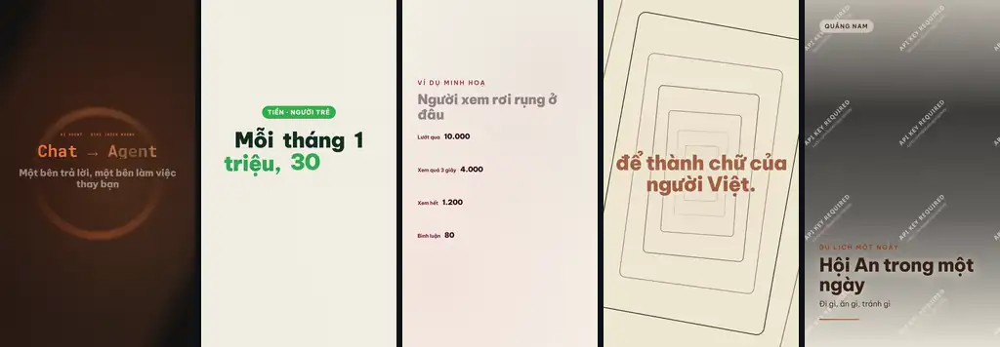
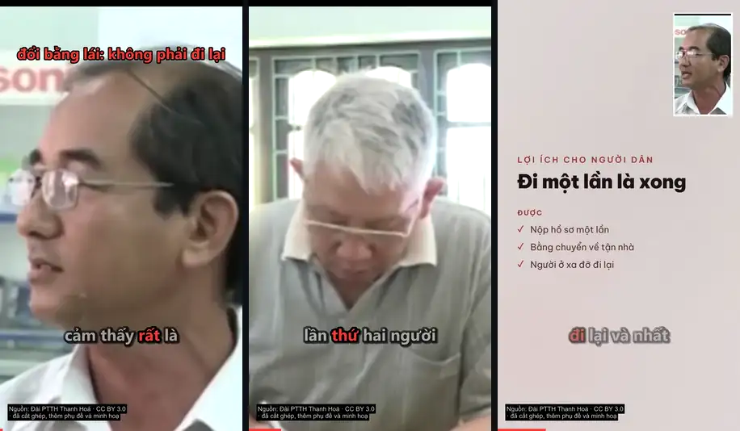

<div align="center">

# 🎬 content-agent-kit

### Trợ lý làm nội dung bằng tiếng Việt — bạn chỉ cần nói với AI

**Tìm chủ đề → viết bài → dựng video 9:16 → duyệt → đăng · chạy quảng cáo Facebook · học marketing từ 8 thương hiệu**

Không cần biết lập trình. Không cần biết dựng phim. Phần lớn tính năng miễn phí.

[](https://github.com/XuHo-IT/Content-Agent-Kit/actions/workflows/ci.yml)
[](LICENSE)


**🇻🇳 Tiếng Việt** · [English](README.en.md) · [Bắt đầu nhanh](docs/29-bat-dau-nhanh.md) · [Hướng dẫn kỹ thuật](docs/00-huong-dan-chi-tiet.md)

<br>

<a href="examples/niche-samples/"></a>

<sub>Năm video do kit tự dựng, chạy song song. Mỗi cột ghép những đoạn chuyển động đẹp nhất <b>trải đều từ đầu đến cuối video</b> — không chỉ vài giây mở đầu.</sub>

</div>

---

## Bộ kit này là gì?

Một bộ "kỹ năng" (skill) cài vào trợ lý AI như **Claude Code** hoặc **Antigravity**. Sau khi cài,
bạn chỉ việc nói bằng tiếng Việt — *"làm video về cách chọn size áo"*, *"mẫu quảng cáo nào đang
đuối?"*, *"học cách Grab tìm insight cho shop tôi"* — và AI tự làm theo quy trình có sẵn: từng
bước một, báo cho bạn đang làm gì, và **luôn hỏi lại trước khi đăng bài hay đụng vào tài khoản
quảng cáo**.

Hợp với: shop online, thương hiệu nhỏ, người làm marketing, nhà sáng tạo nội dung, kênh tin tức
— bất kỳ ai cần ra nội dung đều đặn mà không có cả một đội.

<table>
<tr>
<td width="33%" valign="top">

### 🔎 Tìm ý tưởng
Chủ đề đang hot từ Reddit, Hacker News, GitHub, Google News, Google Trends VN (miễn phí).
Soi đối thủ: video nào đang bứt phá, **chủ đề họ làm mà bạn chưa làm**. Lịch sale Việt Nam
thành kế hoạch theo quý.

</td>
<td width="33%" valign="top">

### ✍️ Viết và đăng
Viết bài mới từ nguồn có trích dẫn — **không chép**. Một AI khác chấm bài trước khi đăng.
Một bài thành nhiều bài cho từng kênh. Tối ưu để Google và ChatGPT, Perplexity dễ trích dẫn bạn.

</td>
<td width="33%" valign="top">

### 🎬 Làm video 9:16
**135 kiểu khung hình động**, 16 bảng màu theo ngành. Video kể chuyện, giọng đọc tiếng Việt
miễn phí, phụ đề sáng từng từ. Dựng video tự quay: cắt khoảng lặng, thêm thẻ minh hoạ.

</td>
</tr>
<tr>
<td valign="top">

### 📣 Quảng cáo Facebook
Ma trận thử mẫu, soát câu dễ bị Meta từ chối, phát hiện mẫu đang đuối, lọc bình luận
(hiểu cả "sz m con k"), chia tệp khách, soát catalog, brief KOC. Chỉ cần file xuất Ads Manager.

</td>
<td valign="top">

### 🏆 Học từ 8 thương hiệu
Cách **Grab** tìm insight, **Biti's Hunter** định vị và kể chuyện, **MoMo** làm viral,
**Highlands** giữ chân khách… — thành phiếu bài tập cho chính thương hiệu của bạn.
[Xem bên dưới ↓](#-học-marketing-từ-8-thương-hiệu)

</td>
<td valign="top">

### 🎨 Thương hiệu
Lấy màu từ website của bạn cho video; làm ảnh chiến dịch qua Canva (nếu bạn dùng Canva).
Không gradient tím-xanh, không chữ phát sáng — không "mùi AI".

</td>
</tr>
</table>

## 🎬 Video mẫu — 16 ngành, 16 phong cách

Mỗi video dài khoảng **1 phút 20 giây**, 9–10 cảnh, do kit tự làm từ một đoạn kịch bản: khung
hình động, chữ chạy, giọng đọc tiếng Việt và nhạc nền. Mỗi ngành một bảng màu và một bộ khung
riêng — 16 video dùng tổng cộng 83 kiểu khung khác nhau.

Mỗi ảnh động dưới đây ghép **7 khoảnh khắc nhiều chuyển động nhất, lấy đều từ đầu đến cuối video**
(biểu đồ đang vẽ, số đang lăn, bản đồ, so sánh, meme, lời kết), nên bạn thấy được cả video trông ra
sao. **Bấm vào ảnh để xem bản đầy đủ có tiếng.**

| | | | |
|:---:|:---:|:---:|:---:|
| [](examples/niche-samples/cong-nghe-ai/video.mp4) | [](examples/niche-samples/lap-trinh/video.mp4) | [](examples/niche-samples/tai-chinh/video.mp4) | [](examples/niche-samples/doanh-nghiep/video.mp4) |
| **AI & Công nghệ** | **Lập trình** | **Tài chính cá nhân** | **Doanh nghiệp** |
| [](examples/niche-samples/marketing/video.mp4) | [](examples/niche-samples/thuong-mai-dien-tu/video.mp4) | [](examples/niche-samples/logistics/video.mp4) | [](examples/niche-samples/game/video.mp4) |
| **Marketing** | **Bán hàng & TMĐT** | **Logistics** | **Game** |
| [](examples/niche-samples/giao-duc/video.mp4) | [](examples/niche-samples/lich-su/video.mp4) | [](examples/niche-samples/tin-tuc/video.mp4) | [](examples/niche-samples/phap-ly/video.mp4) |
| **Giáo dục** | **Lịch sử** | **Tin tức** | **Pháp lý** |
| [](examples/niche-samples/y-te/video.mp4) | [](examples/niche-samples/moi-truong/video.mp4) | [](examples/niche-samples/du-lich/video.mp4) | [](examples/niche-samples/bat-dong-san/video.mp4) |
| **Sức khoẻ** | **Môi trường** | **Du lịch** | **Bất động sản** |

## ✂️ Có sẵn video quay người nói? Kit dựng thành video hoàn chỉnh

<div align="center">

<a href="examples/talking-head-demo/hoan-chinh.mp4"></a>

<sub>Một video, ba khoảnh khắc khác nhau chạy cùng lúc — người thật đang kể, thẻ con số lăn, biểu đồ vẽ bút chì, "Cách làm 1", "Trước đây → Bây giờ", lời kết. <b>Bấm để xem bản đầy đủ 63 giây có tiếng.</b></sub>

</div>

Một phóng sự truyền hình **quay ngang 2 phút 26 giây** → **video dọc 63 giây hoàn chỉnh**:

| | Kit đã làm |
|---|---|
| ✂️ | Ghép 4 đoạn nói hay nhất, cắt khoảng lặng, cắt khung dọc bỏ logo và thanh chữ của đài |
| 💬 | Phụ đề sáng từng từ, chỉnh màu theo phong cách |
| 🧩 | **8 thẻ minh hoạ** hiện đúng lúc người nói nhắc tới: con số, biểu đồ, danh sách, các bước, trước/sau |
| 🖼️ | Khi người thật đang kể, họ vẫn hiện trong khung nhỏ ở góc |

[Xem cách làm →](examples/talking-head-demo/) · Nguồn: Đài PTTH Thanh Hoá, giấy phép CC BY 3.0.

Cùng đoạn quay đó, mỗi phong cách một lệnh (mỗi ảnh ghép 5 khoảnh khắc từ đầu đến cuối):

| Clean | Pop | Editorial | Cinematic | Kinetic doc |
|:---:|:---:|:---:|:---:|:---:|
| [](examples/talking-head-demo/clean.mp4) | [](examples/talking-head-demo/pop.mp4) | [](examples/talking-head-demo/editorial.mp4) | [](examples/talking-head-demo/cinematic.mp4) | [](examples/talking-head-demo/kinetic-doc.mp4) |
| chữ trắng, một từ nhấn màu | CHỮ HOA trong ô màu | chữ mờ dần, màu dịu | màu phim, hạt | đen trắng, một từ đỏ |

## 🏆 Học marketing từ 8 thương hiệu

Mỗi thương hiệu được nhắc tới vì làm tốt **một** việc. Kit lấy **cách làm** của việc đó, hỏi bạn
từng câu, rồi áp vào thương hiệu của bạn — không chép khẩu hiệu, nhạc hay chiến dịch của ai.

| Học từ | Bài học | Bạn nhận được |
|---|---|---|
| **Grab** | Tìm insight, giải quyết vấn đề khách hàng | Câu insight *"Khách muốn ___, nhưng ___, vì ___"* từ bình luận thật |
| **Biti's Hunter** | Định vị thương hiệu và storytelling | Câu định vị, một vùng cảm xúc, chuỗi video kể chuyện |
| **PNJ** | Biến insight thành chiến dịch và doanh thu | Ý tưởng lớn + thứ cụ thể để mua + đúng dịp + mục tiêu bằng số |
| **Cocoon** | Xây dựng thương hiệu và cộng đồng | Giá trị có bằng chứng, nghi thức cộng đồng, brief nội dung từ khách |
| **Vinamilk** | Brand strategy và tái định vị | Giữ gì, đổi gì, nói vì sao đổi, đổi đồng loạt |
| **MoMo** | Growth marketing và viral | Phễu tăng trưởng, vòng giới thiệu bạn bè, cơ chế theo mùa |
| **Highlands Coffee** | CRM và giữ chân khách hàng | Chia nhóm khách, hành trình từng nhóm, đo tỷ lệ quay lại |
| **Coca-Cola** | Cultural marketing và brand experience | Khoảnh khắc văn hoá, vai của thương hiệu, trải nghiệm khách tự tham gia |

Nói: *"Học cách **Highlands** giữ chân khách cho tiệm bánh của tôi"* hoặc chỉ cần nói vấn đề —
*"khách mua một lần rồi không quay lại"* — kit tự chọn bài hợp. [Phương pháp chi tiết →](docs/32-bai-hoc-thuong-hieu.md)

---

## 🚀 Bắt đầu trong 4 bước

1. **Chuẩn bị máy** (một lần): Windows, macOS hoặc Linux có Google Chrome, cài thêm Node.js và
   FFmpeg. Trên Windows, mở PowerShell và dán:
   ```
   winget install OpenJS.NodeJS.LTS Gyan.FFmpeg
   ```
   macOS: `brew install node ffmpeg`
2. **Tải bộ kit**: bấm nút xanh **Code → Download ZIP** ở đầu trang rồi giải nén.
3. **Cài skill** vào trợ lý AI — chọn một cách:
   - Trong Claude Code, gõ `/plugin marketplace add XuHo-IT/Content-Agent-Kit`
     rồi `/plugin install content-agent-kit@content-agent-kit`; **hoặc**
   - mở dòng lệnh trong thư mục kit, chạy `node scripts/install-skills.mjs --kit --global`.
   - Antigravity: chỉ cần mở thư mục kit, không cần cài.
4. **Khởi động lại trợ lý AI và nói** việc bạn muốn (xem bảng bên dưới). Chưa biết bắt đầu từ
   đâu? Nói **"bắt đầu"** — skill `creator-start` hỏi bạn đang có gì rồi dẫn vào đúng việc.

Chi tiết từng bước, cách kiểm tra đã cài được chưa và cách gỡ lỗi:
**[Bắt đầu nhanh](docs/29-bat-dau-nhanh.md)**.

## 💬 Dùng thế nào? Chỉ cần nói

| Bạn muốn | Hãy nói |
|---|---|
| Tạo bộ máy làm nội dung cho ngành của bạn | *"Tạo cho tôi một agent nội dung về **mỹ phẩm handmade**"* |
| Biết hôm nay có gì hot | *"Hôm nay có gì hot về **xe điện**?"* |
| Soi đối thủ | *"Phân tích kênh **@ten-kenh-doi-thu** giúp tôi"* |
| Viết bài đăng mỗi ngày | *"Tạo nội dung hôm nay"* |
| Làm một video | *"Làm video 60 giây về **cách chọn kem chống nắng**"* |
| Video kể chuyện | *"Làm video **câu chuyện thương hiệu** cho shop, có bước ngoặt và lời khách hàng thật"* |
| Dựng video tự quay | *"Cắt khoảng lặng và thêm phụ đề cho file **video-cua-toi.mp4**, phong cách **pop**"* |
| Học từ thương hiệu lớn | *"Làm chiến dịch Tết kiểu **PNJ** cho shop trang sức của tôi"* |
| Bản tiếng Anh cho khách quốc tế | *"Làm lại video này **bằng tiếng Anh**, giọng Google TTS"* |
| Đăng Zalo, Shopee, TikTok Shop | *"Làm **gói đăng** Zalo và Shopee Video cho video này"* |
| Xem đã tiêu bao nhiêu | *"Tháng này tôi đã tiêu bao nhiêu cho video AI?"* |
| Cảnh quay AI như thật | *"Làm cảnh mở đầu bằng **Higgsfield**, báo giá trước khi chạy"* |
| Soát quảng cáo | *"Soát chính sách mấy mẫu quảng cáo này"* (dán nội dung) |
| Canh quảng cáo | *"Mẫu nào đang đuối?"* (gửi file xuất Ads Manager) |
| Trả lời bình luận | *"Lọc bình luận quảng cáo hôm qua"* (gửi file bình luận) |
| Lên kế hoạch sale | *"Lên kế hoạch quảng cáo quý 1, ngân sách 60 triệu"* |

### Khi AI làm việc, bạn sẽ thấy

1. Một câu nói trước sẽ làm gì, mất bao lâu, bạn cần chuẩn bị gì.
2. Báo từng bước: *"Bước 2/5 — Kiểm tra kịch bản…"*.
3. Chỉ hỏi bạn **một việc mỗi lần** (dán số liệu, chọn câu, duyệt bản nháp).
4. **Dừng lại hỏi** trước khi đăng bài, sửa quảng cáo thật, ẩn bình luận.
5. Cuối cùng: kết quả nằm ở đâu, nên làm gì tiếp.

## 💰 Có mất tiền không?

**✅ Miễn phí:** làm video với 135 mẫu khung hình, 16 bảng màu, hiệu ứng âm thanh · giọng đọc chạy
trên máy (OmniVoice) · tìm chủ đề hot, phân tích kênh YouTube và báo · cắt khoảng lặng, phụ đề,
ảnh bìa · toàn bộ công cụ quảng cáo Facebook (chạy trên file xuất) · 8 bài học marketing.

**💳 Tuỳ chọn trả phí — chọn theo việc bạn cần.** Không bắt buộc; thêm khoá vào `.env` khi muốn dùng.

| Việc | Nhà cung cấp | Hợp với | Thanh toán |
|---|---|---|---|
| 🎙️ Giọng đọc tiếng Việt | **Vbee** · **FPT AI** · **Viettel AI** | giọng ba miền, kênh trong nước | VND, dịch vụ trong nước |
| 🌏 Giọng đọc nhiều ngôn ngữ | **ElevenLabs** · **Google Cloud TTS** (50+ ngôn ngữ) · **Azure Speech** (140+ ngôn ngữ) | kênh quốc tế, lồng tiếng Anh, Nhật, Thái, Hàn… | thẻ quốc tế; Google, Azure có hạn mức miễn phí |
| 🎥 Video AI quay như thật | **Google Veo** · **fal.ai** (Kling, Hailuo, Seedance, Wan) · **Higgsfield** (Kling 3.0, Seedance 2.0, Hailuo 2.3) | cảnh template không vẽ được: món ăn, phố xá, sản phẩm | thẻ quốc tế; **báo giá trước, dừng khi vượt trần chi phí** |
| 📤 Đăng bài tự động | **Make.com** (có gói miễn phí) · **Ayrshare** | đăng TikTok, Facebook, Instagram, YouTube, Threads, LinkedIn… không cần dựng kịch bản | thẻ quốc tế |
| 📊 Dữ liệu mạng xã hội | **Apify** | soi xu hướng TikTok, Instagram, Facebook | thẻ quốc tế |

Bạn vẫn cần trợ lý AI (Claude Code hoặc Antigravity) theo gói của nhà cung cấp đó. Phần trả phí
của bộ kit luôn **báo giá trước** và chỉ chạy khi bạn tự thêm khoá (key) vào file `.env`.
Mọi lần gọi trả phí được ghi sổ; đặt **trần chi phí theo tháng** để kit tự dừng trước khi vượt. Kiểm khoá có chạy không (miễn phí): *"kiểm tra các khoá trả phí"*.
Chi tiết: [giọng đọc](docs/14-video-generation.md) · [video AI](docs/20-video-backends.md) · [đăng bài](docs/11-social-posting.md).

## ❓ Câu hỏi thường gặp

<details>
<summary><b>AI có tự đăng bài hay tự sửa quảng cáo không?</b></summary>

Không. Mọi việc không rút lại được — đăng bài, sửa/tắt quảng cáo, ẩn bình luận — đều chờ bạn đồng ý.
</details>

<details>
<summary><b>Video có bị "mùi AI" không?</b></summary>

Bảng màu chọn theo ngành, không gradient tím-xanh hay chữ phát sáng. Phụ đề và nhịp cắt theo
kiểu video đang thịnh hành.
</details>

<details>
<summary><b>Có được dùng video, bài của người khác không?</b></summary>

Kit chỉ lấy *ý tưởng và số liệu có nguồn*, luôn viết lại nội dung mới. Video của người khác chỉ
dùng khi giấy phép cho phép, và luôn ghi nguồn. Lời khen, thư của khách trong video kể chuyện
phải là **thật** và được họ cho phép.
</details>

<details>
<summary><b>"Học từ Grab, PNJ…" có phải chép chiến dịch của họ không?</b></summary>

Không. Kit dạy *cách làm* (tìm insight, định vị, giữ chân khách…), áp vào thương hiệu của bạn.
Không dùng tên, logo, nhạc, khẩu hiệu của họ. Điều kể về các thương hiệu này được ghi "cần kiểm
chứng" — muốn nhắc tới trong bài phải có nguồn.
</details>

<details>
<summary><b>Dữ liệu khách hàng có an toàn không?</b></summary>

File khách hàng chỉ được xuất ở dạng đã mã hoá (băm) và chỉ dùng khi khách đã đồng ý, theo
Nghị định 13/2023.
</details>

<details>
<summary><b>Soát quảng cáo có thay được luật sư không?</b></summary>

Không. Công cụ chỉ bắt các lỗi hay gặp và luôn ghi *"không phải tư vấn pháp lý"*.
</details>

<details>
<summary><b>Muốn đổi màu theo thương hiệu?</b></summary>

Nói: *"Lấy màu từ website **ten-mien-cua-ban.vn** cho video"*.
</details>

---

## 📚 Tìm hiểu sâu hơn

| | |
|---|---|
| 🚀 [Bắt đầu nhanh](docs/29-bat-dau-nhanh.md) | Cài đặt, kiểm tra, gỡ lỗi |
| 📘 [Hướng dẫn kỹ thuật chi tiết](docs/00-huong-dan-chi-tiet.md) | Toàn bộ tính năng, thư viện mẫu khung hình, các lệnh |
| 📖 [Video kể chuyện](docs/27-storytelling.md) · 📣 [Facebook ads](docs/28-facebook-ads.md) | Câu chuyện có bước ngoặt; quảng cáo cho shop |
| 🏆 [Học từ 8 thương hiệu](docs/32-bai-hoc-thuong-hieu.md) | Insight, định vị, chiến dịch, cộng đồng, tăng trưởng, giữ chân, văn hoá |
| 🎨 [Bảng màu](docs/25-palettes.md) · ✂️ [Tự dựng video](docs/26-auto-edit.md) · 🔍 [Đối thủ](docs/24-competitor-analysis.md) | |
| 🎬 [Kỹ thuật dựng + kiểm file](docs/31-ky-thuat-dung.md) | Cắt theo hành động, match cut, theo nhịp nhạc; thông số TikTok, Reels, Shorts, Shopee, Zalo |
| 🧩 [Danh mục khung hình](video-templates/CATALOG.md) · [Bộ khung kể chuyện](examples/gallery/gallery-story.jpg) | |
| 🧭 Kit tự cập nhật | `freshness-check` kiểm luật, chính sách, thông số đã cũ chưa; `performance-review` học từ số liệu kênh |
| 🗺️ [Đề xuất làm tiếp](docs/30-de-xuat-tiep-theo.md) · 🤖 [AGENTS.md](AGENTS.md) | Kế hoạch; hướng dẫn cho trợ lý AI |

<div align="center">

Giấy phép **MIT** · Ghi công mã nguồn và tư liệu: [NOTICE.md](NOTICE.md) · Đóng góp: [CONTRIBUTING.md](CONTRIBUTING.md)

</div>
