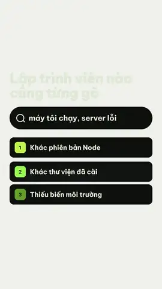
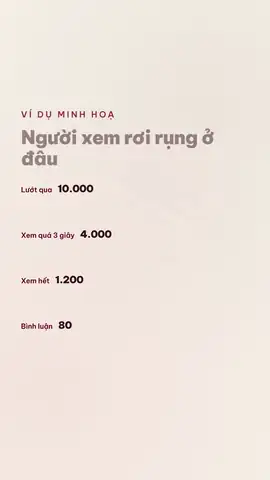
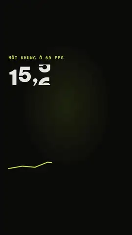

<div align="center">

# content-agent-kit

**Trợ lý làm nội dung bằng tiếng Việt: tìm chủ đề → viết bài → dựng video 9:16 → duyệt → đăng,
và giúp chạy quảng cáo Facebook — bạn chỉ cần nói với AI.**

Không cần biết lập trình. Không cần biết dựng phim. Phần lớn tính năng miễn phí.

[](https://github.com/XuHo-IT/Content-Agent-Kit/actions/workflows/ci.yml)
[](LICENSE)

**🇻🇳 Tiếng Việt** · [English](README.en.md) · [Bắt đầu nhanh](docs/29-bat-dau-nhanh.md) · [Hướng dẫn kỹ thuật chi tiết](docs/00-huong-dan-chi-tiet.md)

</div>

---

## Bộ kit này là gì?

Một bộ "kỹ năng" (skill) cài vào trợ lý AI như **Claude Code** hoặc **Antigravity**. Sau khi cài,
bạn chỉ việc nói bằng tiếng Việt — *"làm video về cách chọn size áo"*, *"mẫu quảng cáo nào đang
đuối?"* — và AI tự làm theo quy trình có sẵn: từng bước một, báo cho bạn đang làm gì, và **luôn
hỏi lại trước khi đăng bài hay đụng vào tài khoản quảng cáo**.

Hợp với: shop online, thương hiệu nhỏ, người làm marketing, nhà sáng tạo nội dung, kênh tin tức
— bất kỳ ai cần ra nội dung đều đặn mà không có cả một đội.

## Làm được gì?

### 🔎 1. Tìm ý tưởng
- **Chủ đề đang hot** theo từ khoá bạn đưa: gom từ Reddit, Hacker News, GitHub, Google News,
  Google Trends Việt Nam (miễn phí); thêm TikTok, Instagram, YouTube, Facebook nếu bạn muốn.
- **Soi đối thủ**: kênh YouTube, trang báo — video nào đang bứt phá, cách họ đặt tiêu đề, giờ
  đăng, và **chủ đề họ làm mà bạn chưa làm**.
- **Lịch sale Việt Nam** (Tết, 8/3, 9/9 … 12/12, Black Friday) thành kế hoạch nội dung theo quý.

### ✍️ 2. Viết và đăng bài
- Viết bài mới từ nguồn có trích dẫn — **không chép**, chỉ lấy ý và số liệu có nguồn.
- **Cổng duyệt độc lập**: một AI khác chấm bài trước khi đăng; không đạt thì không đăng.
- **Một bài thành nhiều bài**: rút nhiều góc khác nhau từ một nội dung cho từng kênh.
- Tối ưu để **Google và các công cụ AI** (ChatGPT, Perplexity…) dễ trích dẫn bạn.
- Đăng lên mạng xã hội theo lịch, chạy tự động mỗi ngày.

### 🎬 3. Làm video ngắn 9:16 (TikTok, Reels, Shorts)
- **130 kiểu khung hình động**: biểu đồ, bản đồ, so sánh trước/sau, giá sốc, bình luận, meme…
  với **16 bảng màu theo ngành**, không "mùi AI".
- **Video kể chuyện**: câu chuyện thương hiệu, câu chuyện khách hàng, lịch sử làng nghề, mổ xẻ
  một vụ việc — có bước ngoặt, bằng chứng, cao trào (lật trang, thư tay, tranh cát, truyện tranh…).
- **Giọng đọc tiếng Việt** chạy ngay trên máy (miễn phí), phụ đề sáng từng từ, hiệu ứng âm thanh.
- **Video tự quay**: tự cắt khoảng lặng, thêm phụ đề, cắt khung dọc, chỉnh màu theo 7 phong cách.
- Cảnh minh hoạ, ảnh chụp trang web, bản đồ bay từ trên trời xuống một địa điểm thật.

### 📣 4. Chạy quảng cáo Facebook (shop, thời trang, bán hàng online)

| Việc | AI giúp gì |
|---|---|
| Lên mẫu quảng cáo | Ma trận thử nghiệm hook × góc × định dạng, đặt tên mẫu để đọc kết quả dễ |
| Soát trước khi chạy | Bắt câu dễ bị Meta từ chối ("Bạn béo bụng?", "rẻ nhất", trước/sau), giảm giá thiếu giá gốc |
| Canh quảng cáo | Phát hiện mẫu đang đuối từ file xuất Ads Manager, đề xuất làm mới |
| Bình luận | Lọc câu hỏi size/giá/ship (hiểu cả "sz m con k", "ib e"), soạn sẵn câu trả lời để bạn duyệt |
| Tệp khách hàng | Chia khách cũ theo mức độ mua, xuất file đã mã hoá để tải lên Meta |
| Catalog sản phẩm | Soát feed cho quảng cáo động: giá, size, màu, ảnh |
| KOC/UGC | Brief cho người sáng tạo, quyền sử dụng nội dung |
| Báo cáo | Từ số liệu → quyết định tuần sau làm gì |

Tất cả chạy được **chỉ với file xuất từ Ads Manager**, không cần kết nối tài khoản.

### 🎨 5. Thiết kế và thương hiệu
- Lấy màu từ website của bạn cho video; làm ảnh chiến dịch qua Canva (nếu bạn dùng Canva).

## Bắt đầu trong 4 bước

1. **Chuẩn bị máy** (một lần): Windows, macOS hoặc Linux có Google Chrome, cài thêm Node.js và
   FFmpeg. Trên Windows, mở PowerShell và dán:
   ```
   winget install OpenJS.NodeJS.LTS Gyan.FFmpeg
   ```
   macOS: `brew install node ffmpeg`
2. **Tải bộ kit**: bấm nút xanh **Code → Download ZIP** ở đầu trang rồi giải nén.
3. **Cài skill** vào trợ lý AI — chọn một cách:
   - Trong Claude Code, gõ `/plugin marketplace add XuHo-IT/Content-Agent-Kit`
     rồi `/plugin install content-agent-kit@content-agent-kit`; **hoặc**
   - mở dòng lệnh trong thư mục kit, chạy `node scripts/install-skills.mjs --kit --global`.
   - Antigravity: chỉ cần mở thư mục kit, không cần cài.
4. **Khởi động lại trợ lý AI và nói** việc bạn muốn (xem bảng bên dưới).

Chi tiết từng bước, cách kiểm tra đã cài được chưa và cách gỡ lỗi:
**[Bắt đầu nhanh](docs/29-bat-dau-nhanh.md)**.

## 🎬 Video mẫu — 16 ngành, 16 phong cách

Mỗi video dài khoảng 1 phút 20 giây, gồm 9–10 cảnh, do bộ kit tự làm từ một đoạn kịch bản:
khung hình động, chữ chạy, giọng đọc tiếng Việt và nhạc nền. Mỗi ngành có **bảng màu riêng**
và một bộ khung hình riêng (sơ đồ, biểu đồ, bản đồ vệ tinh, tờ báo cũ, cửa sổ code, meme…);
16 video dùng tổng cộng 83 kiểu khung khác nhau. Bấm vào ảnh để xem video có tiếng.

| | | | |
|:---:|:---:|:---:|:---:|
| [](examples/niche-samples/cong-nghe-ai/video.mp4) | [](examples/niche-samples/lap-trinh/video.mp4) | [](examples/niche-samples/tai-chinh/video.mp4) | [](examples/niche-samples/doanh-nghiep/video.mp4) |
| **AI & Công nghệ** | **Lập trình** | **Tài chính cá nhân** | **Doanh nghiệp** |
| [](examples/niche-samples/marketing/video.mp4) | [](examples/niche-samples/thuong-mai-dien-tu/video.mp4) | [](examples/niche-samples/logistics/video.mp4) | [](examples/niche-samples/game/video.mp4) |
| **Marketing** | **Bán hàng & TMĐT** | **Logistics** | **Game** |
| [](examples/niche-samples/giao-duc/video.mp4) | [](examples/niche-samples/lich-su/video.mp4) | [](examples/niche-samples/tin-tuc/video.mp4) | [](examples/niche-samples/phap-ly/video.mp4) |
| **Giáo dục** | **Lịch sử** | **Tin tức** | **Pháp lý** |
| [](examples/niche-samples/y-te/video.mp4) | [](examples/niche-samples/moi-truong/video.mp4) | [](examples/niche-samples/du-lich/video.mp4) | [](examples/niche-samples/bat-dong-san/video.mp4) |
| **Sức khoẻ** | **Môi trường** | **Du lịch** | **Bất động sản** |

### Có sẵn video quay người nói? Kit dựng thành video hoàn chỉnh

| [](examples/talking-head-demo/hoan-chinh.mp4) | Một phóng sự quay ngang 2 phút 26 giây → **video dọc 63 giây hoàn chỉnh**: <br><br>ghép 4 đoạn nói hay nhất, cắt khoảng lặng, cắt khung dọc, phụ đề sáng từng từ, và **8 thẻ minh hoạ** hiện đúng lúc người nói nhắc tới (con số, biểu đồ, danh sách, các bước, trước/sau). <br><br>Khi người thật đang kể, họ vẫn hiện trong khung nhỏ ở góc. [Xem cách làm →](examples/talking-head-demo/) |
|:---:|:---|

Cùng đoạn quay đó, dựng theo nhiều phong cách khác nhau:

| Clean | Pop | Editorial | Cinematic | Kinetic doc |
|:---:|:---:|:---:|:---:|:---:|
| [](examples/talking-head-demo/clean.mp4) | [](examples/talking-head-demo/pop.mp4) | [](examples/talking-head-demo/editorial.mp4) | [](examples/talking-head-demo/cinematic.mp4) | [](examples/talking-head-demo/kinetic-doc.mp4) |

Một phóng sự truyền hình quay ngang dài 2 phút 26 giây, được kit tự dựng thành video dọc 1 phút:
ghép 4 đoạn người dân, cán bộ và lời dẫn → chèn cảnh minh hoạ → cắt khoảng lặng → cắt khung dọc
bỏ logo và thanh chữ của đài → phụ đề sáng từng từ → chỉnh màu theo phong cách.
Nguồn: Đài PTTH Thanh Hoá, giấy phép CC BY 3.0 — [chi tiết](examples/talking-head-demo/).

---

## Dùng thế nào? Chỉ cần nói

| Bạn muốn | Hãy nói |
|---|---|
| Tạo bộ máy làm nội dung cho ngành của bạn | *"Tạo cho tôi một agent nội dung về **mỹ phẩm handmade**"* |
| Biết hôm nay có gì hot | *"Hôm nay có gì hot về **xe điện**?"* |
| Soi đối thủ | *"Phân tích kênh **@ten-kenh-doi-thu** giúp tôi"* |
| Viết bài đăng mỗi ngày | *"Tạo nội dung hôm nay"* |
| Làm một video | *"Làm video 60 giây về **cách chọn kem chống nắng**"* |
| Video kể chuyện | *"Làm video **câu chuyện thương hiệu** cho shop, có bước ngoặt và lời khách hàng thật"* |
| Dựng video tự quay | *"Cắt khoảng lặng và thêm phụ đề cho file **video-cua-toi.mp4**, phong cách **pop**"* |
| Soát quảng cáo | *"Soát chính sách mấy mẫu quảng cáo này"* (dán nội dung) |
| Canh quảng cáo | *"Mẫu nào đang đuối?"* (gửi file xuất Ads Manager) |
| Trả lời bình luận | *"Lọc bình luận quảng cáo hôm qua"* (gửi file bình luận) |
| Lên kế hoạch sale | *"Lên kế hoạch quảng cáo quý 1, ngân sách 60 triệu"* |

### Khi AI làm việc, bạn sẽ thấy

1. Một câu nói trước sẽ làm gì, mất bao lâu, bạn cần chuẩn bị gì.
2. Báo từng bước: *"Bước 2/5 — Kiểm tra kịch bản…"*.
3. Chỉ hỏi bạn **một việc mỗi lần** (dán số liệu, chọn câu, duyệt bản nháp).
4. **Dừng lại hỏi** trước khi đăng bài, sửa quảng cáo thật, ẩn bình luận.
5. Cuối cùng: kết quả nằm ở đâu, nên làm gì tiếp.

## Có mất tiền không?

| Miễn phí | Tuỳ chọn, trả phí |
|---|---|
| Làm video: 130 mẫu khung hình, 16 bảng màu, hiệu ứng âm thanh | Giọng đọc cao cấp (Vbee, FPT AI, ElevenLabs…) |
| Giọng đọc chạy trên máy (OmniVoice) | Dữ liệu TikTok/Instagram/Facebook qua Apify |
| Tìm chủ đề hot, phân tích kênh YouTube và báo | Video AI quay như thật (Google Veo) |
| Cắt khoảng lặng, phụ đề, ảnh bìa | |
| Toàn bộ công cụ quảng cáo Facebook (chạy trên file xuất) | |

Bạn vẫn cần trợ lý AI (Claude Code hoặc Antigravity) theo gói của nhà cung cấp đó. Phần trả phí
của bộ kit luôn **báo giá trước** và chỉ chạy khi bạn tự thêm khoá (key) vào file `.env`.

## Câu hỏi thường gặp

**AI có tự đăng bài hay tự sửa quảng cáo không?** Không. Mọi việc không rút lại được — đăng bài,
sửa/tắt quảng cáo, ẩn bình luận — đều chờ bạn đồng ý.

**Video có bị "mùi AI" không?** Bảng màu chọn theo ngành, không gradient tím-xanh hay chữ phát
sáng. Phụ đề và nhịp cắt theo kiểu video đang thịnh hành.

**Có được dùng video, bài của người khác không?** Kit chỉ lấy *ý tưởng và số liệu có nguồn*, luôn
viết lại nội dung mới. Video của người khác chỉ dùng khi giấy phép cho phép, và luôn ghi nguồn.
Lời khen, thư của khách trong video kể chuyện phải là **thật** và được họ cho phép.

**Dữ liệu khách hàng có an toàn không?** File khách hàng chỉ được xuất ở dạng đã mã hoá (băm)
và chỉ dùng khi khách đã đồng ý, theo Nghị định 13/2023.

**Soát quảng cáo có thay được luật sư không?** Không. Công cụ chỉ bắt các lỗi hay gặp và luôn ghi
*"không phải tư vấn pháp lý"*.

**Muốn đổi màu theo thương hiệu?** Nói: *"Lấy màu từ website **ten-mien-cua-ban.vn** cho video"*.

---

## Tìm hiểu sâu hơn

- 🚀 [Bắt đầu nhanh](docs/29-bat-dau-nhanh.md): cài đặt, kiểm tra, gỡ lỗi
- 📘 [Hướng dẫn kỹ thuật chi tiết](docs/00-huong-dan-chi-tiet.md): toàn bộ tính năng, thư viện mẫu khung hình, các lệnh
- 📖 [Video kể chuyện](docs/27-storytelling.md) · 📣 [Facebook ads với Claude](docs/28-facebook-ads.md)
- 🎨 [Bảng màu theo ngành](docs/25-palettes.md) · ✂️ [Tự dựng video](docs/26-auto-edit.md) · 🔍 [Phân tích đối thủ](docs/24-competitor-analysis.md)
- 🎬 [Kỹ thuật dựng + kiểm file trước khi đăng](docs/31-ky-thuat-dung.md): cắt theo hành động, match cut, cắt theo nhịp nhạc; thông số TikTok, Reels, Shorts, Shopee, Zalo
- 🧩 [Danh mục mẫu khung hình](video-templates/CATALOG.md) · [Bộ khung kể chuyện](examples/gallery/gallery-story.jpg)
- 🗺️ [Đề xuất làm tiếp](docs/30-de-xuat-tiep-theo.md): những gì kit sẽ bổ sung
- 🤖 [AGENTS.md](AGENTS.md): hướng dẫn dành cho trợ lý AI

Giấy phép **MIT** · Ghi công mã nguồn và tư liệu: [NOTICE.md](NOTICE.md) · Đóng góp: [CONTRIBUTING.md](CONTRIBUTING.md)
