<div align="center">

# content-agent-kit

**Bộ công cụ tự động hoá nội dung đa kênh: crawl bài, viết chuẩn SEO/GEO, duyệt bài tự động và tạo video 9:16 chuyên nghiệp.**

[](https://github.com/XuHo-IT/Content-Agent-Kit/actions/workflows/ci.yml)
[](LICENSE)
[](#y%C3%AAu-c%E1%BA%A7u)
[](#y%C3%AAu-c%E1%BA%A7u)
[](https://github.com/XuHo-IT/Content-Agent-Kit/discussions)
[](CONTRIBUTING.md)

[English](README.md) · **🇻🇳 Tiếng Việt**

</div>

---

Bộ kit giúp các IDE agentic (**Claude Code**, **Antigravity / Gemini**) tự động thiết lập và vận hành một AI Content Agent hoàn chỉnh: từ tìm kiếm ý tưởng, soạn thảo, thẩm định chất lượng, đăng mạng xã hội đến **dựng video ngắn 9:16 chất lượng cao** với 129 template HTML động, giọng đọc TTS tự nhiên, B-roll và chụp màn hình thực tế.

## Xem nhanh kết quả mẫu

| Định dạng | Mô tả & Đường dẫn |
|---|---|
| 📄 **Bài viết** | [Bài viết mẫu](examples/ai-news-social/sample-output/) — 951 từ chuẩn SEO/GEO, kèm comment tương tác và bảng kiểm định chất lượng |
| 🖼️ **Ảnh bìa** | [Ảnh cover](examples/ai-news-social/sample-output/cover.jpg) — 1024×1024 đồng bộ phong cách bài viết |
| 🎬 **Video 9:16** | [Video mẫu](examples/ai-video-social/sample-output/) — 2 phút 12 giây, giọng đọc Vbee, footage Pexels, chụp web trực tiếp |
| 🎨 **Theme đổi màu** | [Bản paper-blue](examples/ai-video-social/sample-output-paper-blue/) — 16 scene, dùng 14 trong số 129 template, đổi sang nền trắng chữ xanh biển qua `"theme": "paper-blue"` |

> **Tải video mẫu MP4:** [Releases v0.1.0](https://github.com/XuHo-IT/Content-Agent-Kit/releases/tag/v0.1.0) hoặc render bằng lệnh:
> `node scripts/video/render.mjs examples/ai-video-social/sample-output/script.json`

---

## 🚀 Sơ Đồ Luồng Vận Hành Toàn Diện (End-to-End Workflow)

[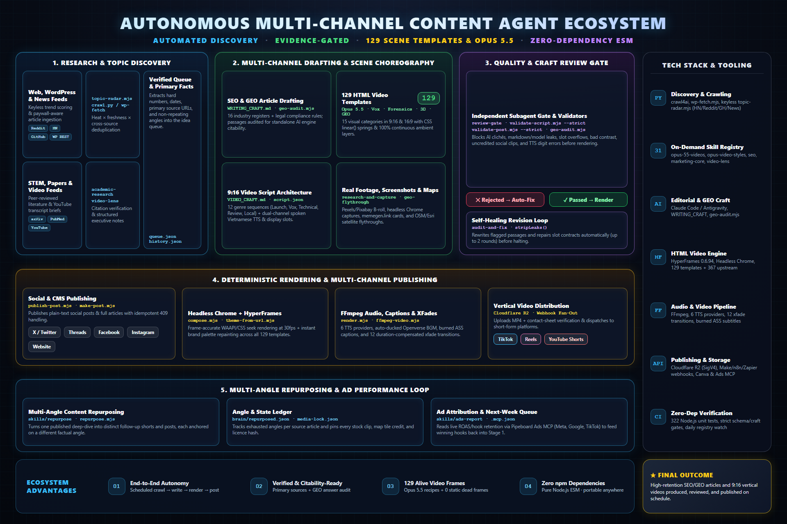](examples/gallery/workflow.png)

---

## Thư viện 129 Video Template (Phân loại theo chức năng)

Toàn bộ 129 template được chia thành **15 danh mục trực quan** với màu sắc, phong cách thiết kế riêng biệt và lớp chuyển động nền liên tục (ambient motion):

### 1. 🌟 Khung Mở Đầu & Hook Thu Hút (Hooks & Heroes — 10 template)
[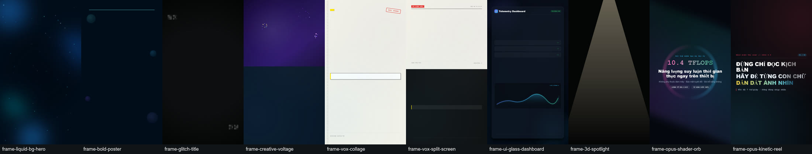](video-templates/CATALOG.md)
*Gồm: `frame-liquid-bg-hero`, `frame-bold-poster`, `frame-glitch-title`, `frame-creative-voltage`, `frame-vox-collage`, `frame-vox-split-screen`, `frame-ui-glass-dashboard`, `frame-3d-spotlight`, `frame-opus-shader-orb`, `frame-opus-kinetic-reel`.*

### 2. ✨ Công Thức Phong Cách Opus 5.5 (Opus 5.5 Style Recipes — 6 template)
[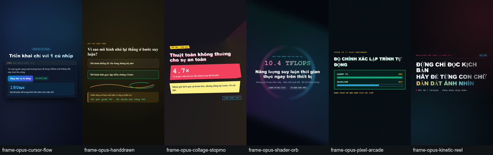](video-templates/CATALOG.md)
*Gồm: `frame-opus-cursor-flow` (giao diện SaaS 3D + con trỏ nhấp chuột lò xo), `frame-opus-handdrawn` (phác thảo nét mực tự vẽ `stroke-dashoffset` + line-boil 12fps), `frame-opus-collage-stopmo` (cắt dán giấy zine + hoạt hình stop-motion `steps()`), `frame-opus-shader-orb` (vòng plasma conic xoay lệch pha + quét sáng `mask-image`), `frame-opus-pixel-arcade` (bảng điểm HUD 8-bit), `frame-opus-kinetic-reel` (typography màn trập đa tầng).*

### 3. 📰 Phóng Sự Điều Tra & Báo Chí (Vox, Statements & Typography — 12 template)
[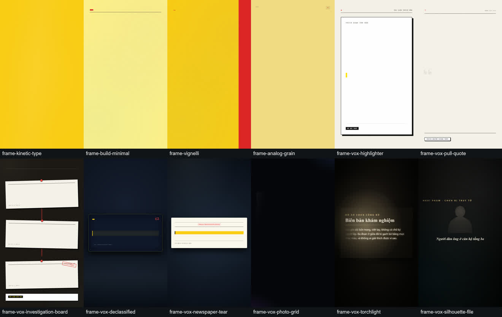](video-templates/CATALOG.md)
*Gồm: `frame-kinetic-type`, `frame-build-minimal`, `frame-vignelli`, `frame-analog-grain`, `frame-vox-highlighter`, `frame-vox-pull-quote`, `frame-vox-investigation-board`, `frame-vox-declassified`, `frame-vox-newspaper-tear`, `frame-vox-photo-grid`, `frame-vox-torchlight`, `frame-vox-silhouette-file`.*

### 4. 📊 Số Liệu, Biểu Đồ & Phân Tích Kỹ Thuật (Data, Charts & Analytics — 13 template)
[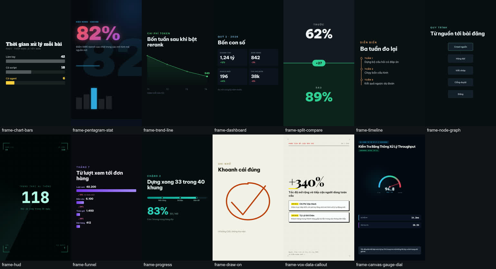](video-templates/CATALOG.md)
*Gồm: `frame-chart-bars`, `frame-pentagram-stat`, `frame-trend-line`, `frame-dashboard`, `frame-split-compare`, `frame-timeline`, `frame-node-graph`, `frame-hud`, `frame-funnel`, `frame-progress`, `frame-draw-on`, `frame-vox-data-callout`, `frame-canvas-gauge-dial`.*

### 5. 🧠 Sơ Đồ Tư Duy & Toán Học Manim (Diagrams, Math & Blueprint — 10 template)
[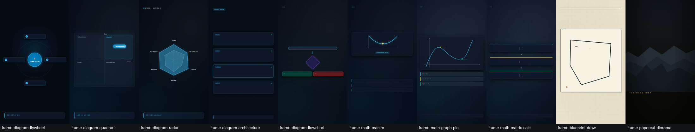](video-templates/CATALOG.md)
*Gồm: `frame-diagram-flywheel`, `frame-diagram-quadrant`, `frame-diagram-radar`, `frame-diagram-architecture`, `frame-diagram-flowchart`, `frame-math-manim`, `frame-math-graph-plot`, `frame-math-matrix-calc`, `frame-blueprint-draw`, `frame-papercut-diorama`.*

### 6. 💻 Footage, IDE Lập Trình, Thiết Bị & 3D (Footage, IDE & 3D — 11 template)
[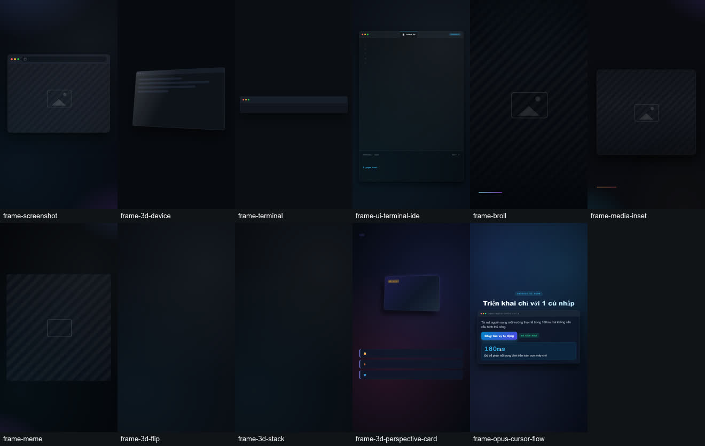](video-templates/CATALOG.md)
*Gồm: `frame-screenshot`, `frame-3d-device`, `frame-terminal`, `frame-ui-terminal-ide`, `frame-broll`, `frame-media-inset`, `frame-meme`, `frame-3d-flip`, `frame-3d-stack`, `frame-3d-perspective-card`, `frame-opus-cursor-flow`.*

### 7. 🗺️ Bản Đồ, Địa Lý & Lịch Trình (GEO, Radar, Heatmap & Local — 10 template)
[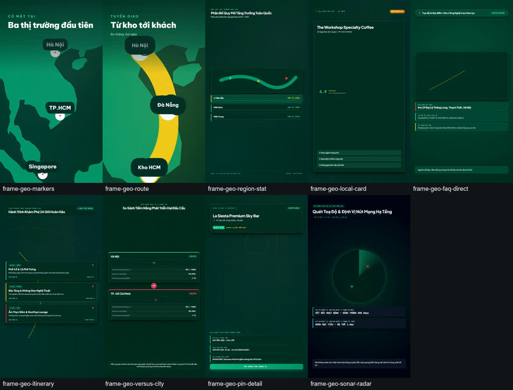](video-templates/CATALOG.md)
*Gồm: `frame-geo-markers`, `frame-geo-route`, `frame-geo-region-stat`, `frame-geo-local-card`, `frame-geo-faq-direct`, `frame-geo-itinerary`, `frame-geo-versus-city`, `frame-geo-pin-detail`, `frame-geo-heatmap`, `frame-geo-sonar-radar`.*

### 8. 🏆 Trình Tự, Phác Thảo & Đóng Video (Sequences, Proof & Closers — 14 template)
[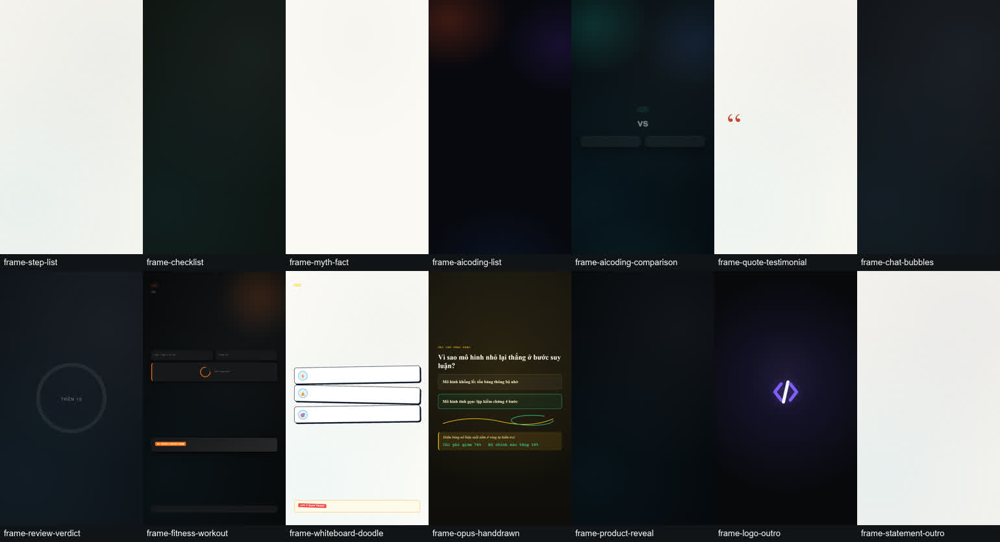](video-templates/CATALOG.md)
*Gồm: `frame-step-list`, `frame-checklist`, `frame-myth-fact`, `frame-aicoding-list`, `frame-aicoding-comparison`, `frame-quote-testimonial`, `frame-chat-bubbles`, `frame-review-verdict`, `frame-fitness-workout`, `frame-whiteboard-doodle`, `frame-opus-handdrawn`, `frame-product-reveal`, `frame-logo-outro`, `frame-statement-outro`.*

### 9. ⚡ Template Hybrid Đa Kỹ Năng (Multi-Skill Hybrid — 2 template)
[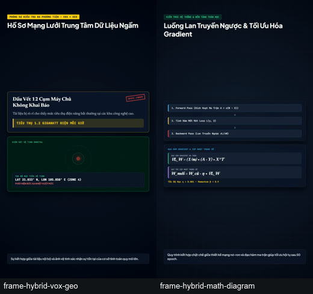](video-templates/CATALOG.md)
*Gồm: `frame-hybrid-vox-geo` (Báo chí Vox + Bản đồ Radar vệ tinh), `frame-hybrid-math-diagram` (Kiến trúc hệ thống + Đạo hàm giải tích Manim).*

### 10. 📈 Tài Chính, Crypto & Kinh Tế (FinTech & Trading — 5 template)
[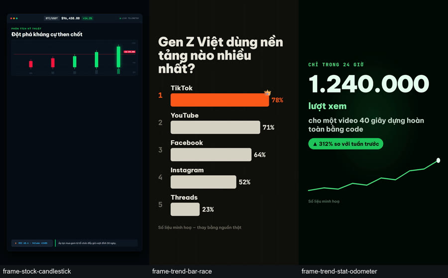](video-templates/CATALOG.md)
*Gồm: `frame-stock-candlestick`, `frame-crypto-orderbook`, `frame-wealth-compound`, `frame-portfolio-donut`, `frame-inflation-purchasing-power`.*

### 11. 🧠 Khoa Học Não Bộ, Tâm Lý Học & Giáo Dục (Science & Psychology — 5 template)
[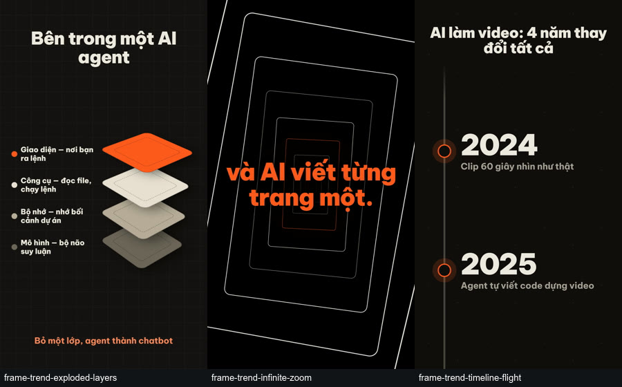](video-templates/CATALOG.md)
*Gồm: `frame-iceberg-levels`, `frame-brain-synapse`, `frame-habit-loop`, `frame-dna-helix-breakdown`, `frame-bell-curve-iq`.*

### 12. 🕵️‍♂️ Phim Tài Liệu, Hồ Sơ Điều Tra & Pháp Y (Documentary & Forensics — 22 template)
[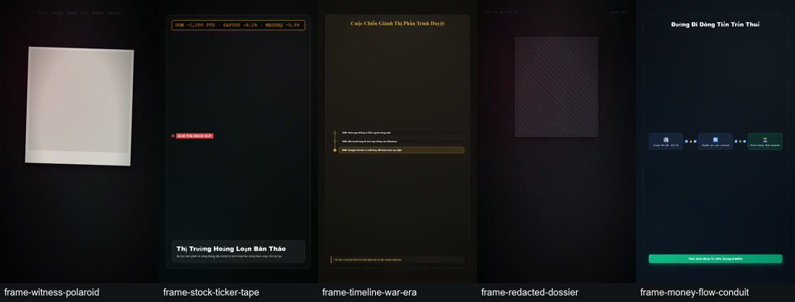](video-templates/CATALOG.md)
*Gồm: `frame-redacted-dossier`, `frame-witness-polaroid`, `frame-archive-newspaper`, `frame-fingerprint-match`, `frame-crime-scene-map`, `frame-satellite-track`, `frame-corkboard-threads`, `frame-forensic-instrument`, `frame-case-dashboard`, `frame-interrogation-log`, `frame-morgue-tag`, `frame-cipher-decrypt`, `frame-vhs-nosignal`, `frame-suspect-lineup`, `frame-polygraph`, `frame-thermal-cam`, `frame-ballistics-path`, `frame-dispatch-waveform`, `frame-forensic-chat`, `frame-stock-ticker-tape`, `frame-timeline-war-era`, `frame-money-flow-conduit`.*

### 13. 🎮 Gamification, Cắt Dán & Giữ Chân Cao (Viral Retention Hooks — 6 template)
[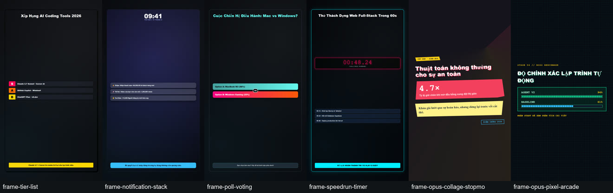](video-templates/CATALOG.md)
*Gồm: `frame-tier-list`, `frame-notification-stack`, `frame-poll-voting`, `frame-speedrun-timer`, `frame-opus-collage-stopmo`, `frame-opus-pixel-arcade`.*

### 14. 💻 SaaS, AI Tooling & Kỹ Thuật Lập Trình (Dev & Tech Explainers — 5 template)
[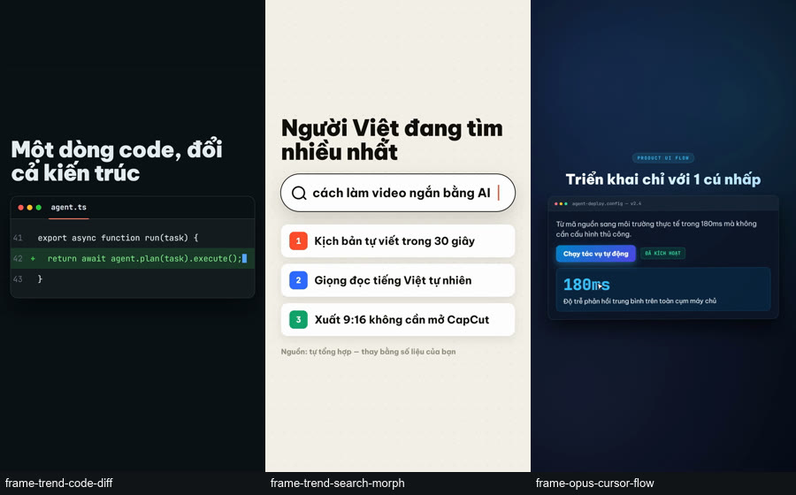](video-templates/CATALOG.md)
*Gồm: `frame-saas-pricing-tier`, `frame-api-request-response`, `frame-diff-code-editor`, `frame-git-branch-graph`, `frame-ai-benchmark-leaderboard`.*

### 15. ⚖️ Đánh Giá, Review & Thương Mại Điện Tử (E-Commerce & Reviews — 4 template)
[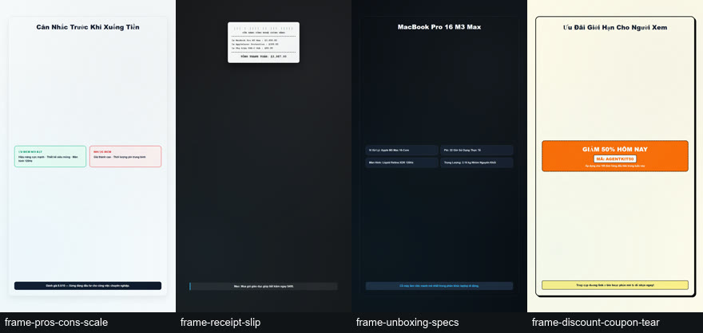](video-templates/CATALOG.md)
*Gồm: `frame-pros-cons-scale`, `frame-receipt-slip`, `frame-unboxing-specs`, `frame-discount-coupon-tear`.*

> Chi tiết tham số slots và giới hạn ký tự: **[`video-templates/CATALOG.md`](video-templates/CATALOG.md)**.
> Xem cấu trúc kịch bản theo 12 thể loại video: **[`docs/21-video-genres.md`](docs/21-video-genres.md)** & **[`templates/VIDEO_GENRES.template.json`](templates/VIDEO_GENRES.template.json)**.

---

## Cấu trúc Bộ Kit

| Thư mục | Chức năng chính |
|---|---|
| `docs/` | 23 tài liệu phương pháp luận ngắn gọn (bilingual EN + VI): viết bài chuẩn SEO, GEO audit, topic radar, pipeline video, media stock, palette website, MCP quảng cáo/Canva |
| `templates/` | Khung mẫu điền sẵn: `PLAYBOOK`, `WRITING_CRAFT`, `VIDEO_CRAFT`, `KNOWLEDGE`, `VIDEO_SCRIPT.json`, `sources.yaml`, `INDUSTRIES.template.json` (16 ngành) |
| `scripts/` | Công cụ CLI hoàn chỉnh (Zero dependency): crawl ý tưởng, publish social, kiểm định bài viết, render video, tải B-roll Pexels, chụp ảnh web |
| `video-templates/` | 129 template video HTML một-file cùng **`CATALOG.md`** — mỗi template tự chứa CSS và animation, render offline mượt mà. 367 template nữa chỉ cách một câu lệnh. |
| `skills/` | 16 skill tích hợp: `bootstrap-content-agent`, `daily-run`, `review-gate`, `audit-and-fix`, `crawl-and-queue`, `topic-radar`, `daily-topic-video`, `create-video`, `video-and-post`, `research-and-capture`, `repurpose`, `ads-report`, `design-campaign`, `geo-optimize`, `motion-craft`, `new-template` + `registry.json` (31 skill ngoài tải theo yêu cầu gồm `opus-55-videos`, `opus-video-skills`, `opus-video-styles`). |
| `examples/` | 2 agent mẫu chạy thực tế: Agent tin tức social và Agent sản xuất video ngắn |

---

## Bắt đầu nhanh trong 3 bước

### 1. Khởi tạo Agent mới
- **Claude Code:** Chạy `/bootstrap-content-agent` — AI sẽ phỏng vấn ngành nghề và mục tiêu để scaffold toàn bộ agent.
- **Antigravity / Gemini:** Nhập yêu cầu: *"Đọc `AGENTS.md` và `docs/`, sau đó tạo cho tôi một agent nội dung cho chủ đề [X]."*

### 2. Vận hành hằng ngày
- Chạy lệnh `/daily-run` để AI tự động crawl ý tưởng mới, viết bài, thẩm định qua cổng review và lên lịch đăng.

### 3. Tạo Video Ngắn (Nếu cần)
```bash
# 1. Kiểm tra kịch bản (vài giây)
node scripts/video/validate-script.mjs brain/<slug>/script.json --strict

# 2. Render video hoàn chỉnh (kèm giọng đọc TTS và footage)
node scripts/video/render.mjs brain/<slug>/script.json

# 3. Tạo ảnh contact sheet xem lại toàn bộ khung hình
node scripts/video/contact-sheet.mjs brain/<slug>/video.mp4
```

---

## Điểm nổi bật & Tính năng cốt lõi

| Tính năng | Chi tiết |
|---|---|
| **6 bộ giọng đọc TTS** | Tích hợp OmniVoice (local miễn phí), Vbee, Viettel AI, FPT AI, ElevenLabs, HTTP custom adapter |
| **Cảnh quay & Ảnh thật** | Tự động tải B-roll Pexels/Pixabay và chụp ảnh website thực tế qua headless Chrome |
| **Phụ đề & Chuyển cảnh** | Đốt phụ đề trực tiếp (`--captions burn`), 12 hiệu ứng chuyển cảnh điện ảnh mượt mà (fade, swipe, slide, iris, pixelize, zoom, whip, radial, slice, squeeze, reveal, cover) |
| **Bảng màu tự động** | Trích xuất bảng màu thương hiệu từ website bất kỳ bằng `theme-from-url.mjs` |
| **129 template, 12 thể loại** | Hỗ trợ 12 thể loại video: Review, Hướng dẫn, Tin tức, Listicle, Ra mắt, Testimonial, Local GEO, Vox Explainer, GEO Answer, Phân tích kỹ thuật, Tăng trưởng, Du lịch |
| **Kiểm định GEO/SEO** | `geo-audit.mjs` tự động chấm điểm khả năng trích dẫn bài viết của các công cụ tìm kiếm AI (SearchGPT, Perplexity, Google Overviews) |

---

## Yêu cầu môi trường

- **Node.js ≥ 18** (Bắt buộc cho mọi tác vụ)
- **Chrome/Chromium + FFmpeg/ffprobe** (Khi render video)
- **Python 3.12** (Chỉ khi sử dụng module crawl mở rộng `crawl4ai`)

> **Không cần `npm install` hay `package.json`**: Bộ kit hoạt động độc lập, sẵn sàng tái sử dụng cho mọi dự án.

## Giấy phép & Đóng góp

- Giấy phép: **MIT** (xem [`LICENSE`](LICENSE)).
- Phần ghi công và mã nguồn kế thừa: xem **[`NOTICE.md`](NOTICE.md)**.
